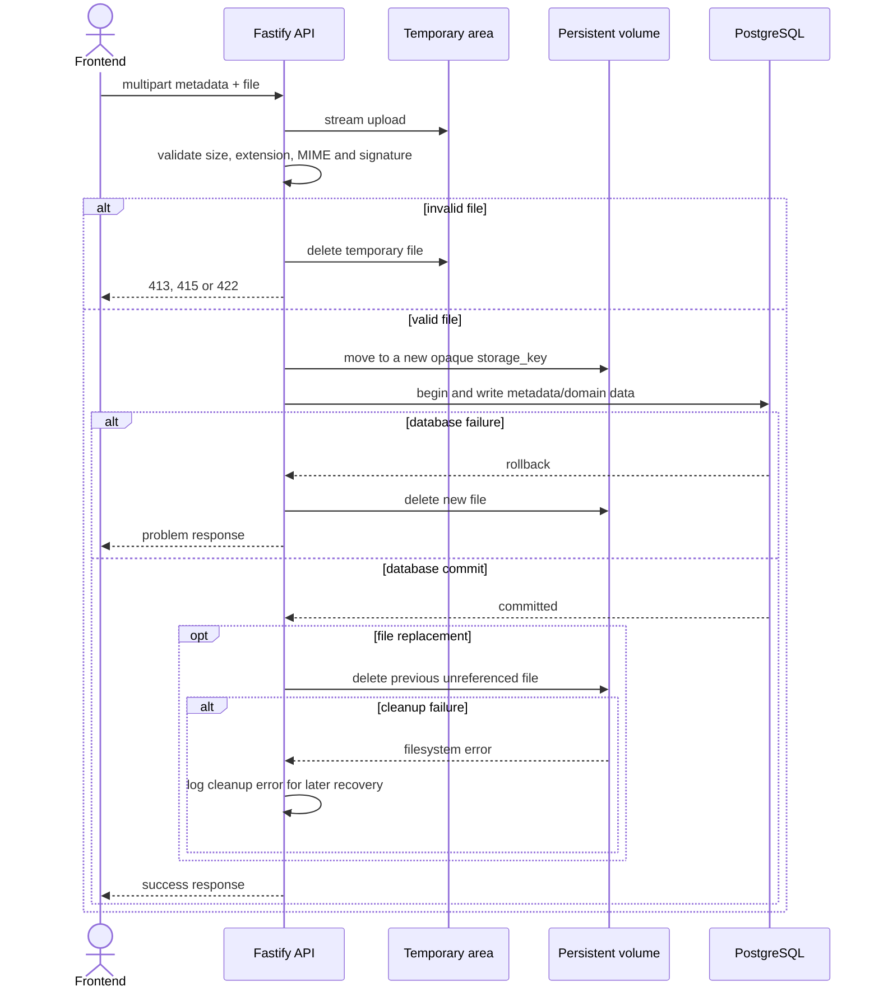

# KUME — Diseño de API

Este documento resume las decisiones del contrato HTTP. La definición ejecutable está en [OpenAPI](openapi.yaml).

## Convenciones

- REST sobre HTTP bajo `/api/v1`; salud y documentación quedan fuera de la versión.
- Rutas plurales en `kebab-case`, propiedades JSON en `camelCase` y UUID en identificadores.
- Fechas civiles en `YYYY-MM-DD`; instantes en ISO 8601 UTC.
- Importes decimales como texto, por ejemplo `"1250.50"`.
- JSON para datos y `multipart/form-data` exclusivamente para cargas de archivos.
- Días: `monday` a `sunday`. Turnos: `morning` y `afternoon`.
- Roles: `teacher`, `assistant` y `workshopInstructor`.
- Sin autenticación en el prototipo; CORS acepta únicamente el origen configurado del frontend.

El frontend traduce valores técnicos mediante mapas de presentación, por ejemplo `morning` → “Matutino”, `afternoon` → “Vespertino” y `monday` → “Lunes”.

## Recursos y rutas

### Sistema

| Método | Ruta | Resultado |
|---|---|---|
| `GET` | `/health` | Estado de la API y de PostgreSQL para Docker Compose |
| `GET` | `/openapi.json` | Contrato OpenAPI servido por la aplicación |
| `GET` | `/documentation` | Interfaz Swagger local |

### Rubros

| Método | Ruta | Resultado |
|---|---|---|
| `GET` | `/api/v1/categories` | Listar por estado |
| `POST` | `/api/v1/categories` | Crear |
| `GET` | `/api/v1/categories/{categoryId}` | Consultar |
| `PATCH` | `/api/v1/categories/{categoryId}` | Editar |
| `POST` | `/api/v1/categories/{categoryId}/deactivation` | Desactivar |
| `DELETE` | `/api/v1/categories/{categoryId}/deactivation` | Reactivar |

### Gastos y comprobantes

| Método | Ruta | Resultado |
|---|---|---|
| `GET` | `/api/v1/expenses` | Listar, filtrar y totalizar |
| `POST` | `/api/v1/expenses` | Crear gasto y comprobante en una carga multipart |
| `GET` | `/api/v1/expenses/export.csv` | Exportar el conjunto filtrado sin paginación |
| `GET` | `/api/v1/expenses/{expenseId}` | Consultar detalle y metadatos del comprobante |
| `PATCH` | `/api/v1/expenses/{expenseId}` | Editar un gasto activo |
| `POST` | `/api/v1/expenses/{expenseId}/cancellation` | Anular |
| `DELETE` | `/api/v1/expenses/{expenseId}/cancellation` | Restaurar |
| `PUT` | `/api/v1/expenses/{expenseId}/receipt` | Reemplazar comprobante |
| `GET` | `/api/v1/expenses/{expenseId}/receipt/content` | Descargar comprobante |

Filtros de gastos: `paymentDateFrom`, `paymentDateTo`, `categoryId`, `status`, `page` y `pageSize`. `status` admite `active`, `cancelled` o `all` y usa `active` por defecto. El total excluye anulados y se calcula sobre todo el conjunto filtrado, no sobre la página.

El CSV usa los mismos filtros sin paginación. Sus columnas son `Fecha de pago`, `Destinatario`, `Concepto`, `Rubro`, `Importe`, `Moneda` y `Estado`; se genera en UTF-8 con BOM, coma, escape RFC 4180 y CRLF.

### Personal y documentos

| Método | Ruta | Resultado |
|---|---|---|
| `GET` | `/api/v1/staff-members` | Buscar por nombre, apellido o cédula y filtrar por estado |
| `POST` | `/api/v1/staff-members` | Crear ficha |
| `GET` | `/api/v1/staff-members/{staffMemberId}` | Consultar con asignaciones y resumen documental |
| `PATCH` | `/api/v1/staff-members/{staffMemberId}` | Editar ficha activa |
| `POST` | `/api/v1/staff-members/{staffMemberId}/deactivation` | Inactivar con fecha de egreso y retirar asignaciones |
| `DELETE` | `/api/v1/staff-members/{staffMemberId}/deactivation` | Reactivar y limpiar fecha de egreso |
| `GET` | `/api/v1/staff-members/{staffMemberId}/documents` | Listar documentos |
| `POST` | `/api/v1/staff-members/{staffMemberId}/documents` | Subir nombre libre y archivo |
| `GET` | `/api/v1/staff-members/{staffMemberId}/documents/{documentId}/content` | Descargar |
| `DELETE` | `/api/v1/staff-members/{staffMemberId}/documents/{documentId}` | Eliminar registro y archivo |

Una ficha inactiva es de solo lectura: se puede consultar y descargar sus archivos, pero no editar, asignar, subir ni eliminar documentos. Reactivarla no restaura las asignaciones anteriores.

### Asignaciones

| Método | Ruta | Resultado |
|---|---|---|
| `GET` | `/api/v1/assignments` | Listar por persona, tipo, destino o turno |
| `POST` | `/api/v1/assignments` | Crear |
| `GET` | `/api/v1/assignments/{assignmentId}` | Consultar |
| `PUT` | `/api/v1/assignments/{assignmentId}` | Reemplazar destino o turno atómicamente |
| `DELETE` | `/api/v1/assignments/{assignmentId}` | Retirar sin historial |

Cada asignación contiene `staffMemberId`, `targetType`, `targetId` y `shift`. `targetType` admite `course` o `workshop`. El rol es informativo y no limita el tipo de destino.

### Cursos y talleres

Ambos recursos permiten listar, crear, consultar, editar, desactivar y reactivar mediante:

- `/api/v1/courses`
- `/api/v1/workshops`
- `/{resource}/{id}`
- `/{resource}/{id}/deactivation`

Un curso expone `name`, `level`, `internalName`, `days` y `shifts`. Un taller expone `name`, `days` y `shifts`. No se puede desactivar un destino con asignaciones.

## Paginación, orden y relaciones

Los listados usan `page` y `pageSize`; sus valores iniciales son 1 y 25, y el máximo de `pageSize` es 100. La forma común es:

```json
{
  "items": [],
  "page": 1,
  "pageSize": 25,
  "totalItems": 0,
  "totalPages": 0
}
```

Órdenes fijos:

- Gastos por `paymentDate` y `createdAt`, ambos descendentes.
- Personal por `lastName` y `firstName` ascendentes.
- Rubros, cursos y talleres por `name` ascendente.
- Documentos por `createdAt` descendente.

Las respuestas incluyen resúmenes de relaciones para evitar peticiones repetidas. Los gastos incluyen rubro y metadatos del comprobante; las asignaciones incluyen destino y persona; el detalle de personal incluye asignaciones y resúmenes documentales.

## Escrituras y estados HTTP

- `POST`: `201 Created`, `Location` y recurso creado.
- `PATCH` y `PUT`: `200 OK` y recurso actualizado.
- Acciones y eliminaciones sin cuerpo: `204 No Content`.
- Descargas y CSV: `200 OK`.
- En `PATCH`, un campo omitido no cambia; `null` limpia únicamente campos opcionales.
- No se implementan ETags ni control optimista de concurrencia en esta versión local y monousuario.

Clasificación de errores:

| Estado | Uso |
|---:|---|
| `400` | Petición o JSON malformado |
| `404` | Recurso inexistente |
| `409` | Unicidad, asignación ocupada o baja bloqueada |
| `413` | Archivo mayor a 10 MB |
| `415` | Tipo de archivo no admitido |
| `422` | Campos o reglas de negocio inválidos |
| `500` | Error inesperado sin detalles internos |

Los errores usan `application/problem+json` con `type`, `title`, `status`, `detail`, `code` y errores opcionales por campo.

## Validaciones principales

- Solo UYU; importe mayor que cero; fecha de pago no futura.
- Un gasto anulado es de solo lectura hasta restaurarlo.
- Cédula uruguaya normalizada, válida y única.
- `birthDate` anterior al día actual; `startDate` no futura; `endDate` no futura ni anterior a `startDate`.
- Personal activo y destino activo para crear o cambiar una asignación.
- Destino y turno disponibles; días y turnos sin duplicados.
- No se puede quitar de un curso o taller un turno que todavía tenga una asignación.
- `internalName` opcional y único cuando existe; la búsqueda de cursos contempla `name` e `internalName`.
- Exactamente un archivo PDF, JPG o PNG de hasta 10 MB por carga.

## Persistencia segura de archivos



El archivo anterior nunca se elimina antes del commit. Si la limpieza posterior falla, se conserva un archivo huérfano para recuperación posterior en vez de arriesgar el archivo vigente.

Al eliminar un documento del personal se confirma primero el borrado de la fila y luego se elimina el archivo. Si esa limpieza falla, se registra el archivo huérfano para recuperación posterior; nunca se elimina primero un archivo todavía referenciado.

## Respaldo y restauración

No se exponen por HTTP. Los scripts manuales respaldan y restauran PostgreSQL y el volumen de archivos como una unidad versionada, con validación previa y confirmación antes de reemplazar datos.
