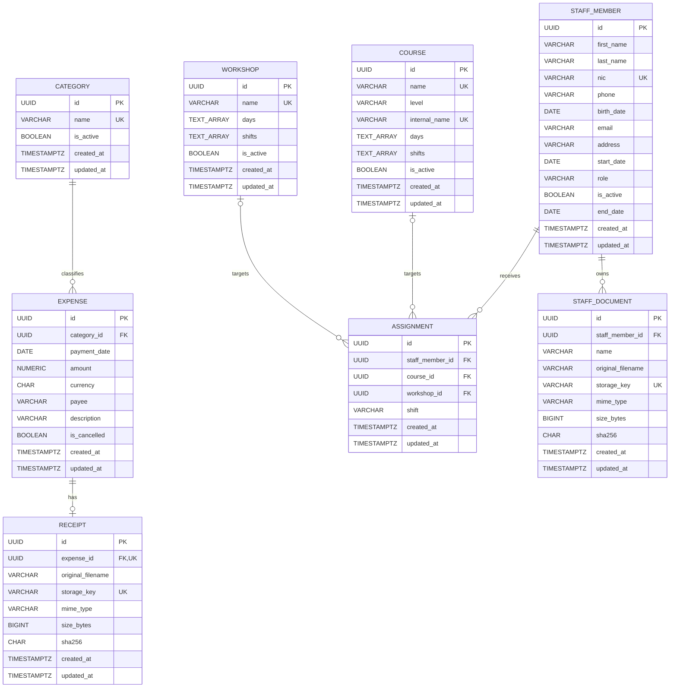

# KUME — Diseño de base de datos

Este documento define el modelo PostgreSQL del prototipo administrativo. Los nombres técnicos están en inglés, las tablas usan singular y las columnas usan `snake_case`. Los textos administrables y visibles para la usuaria permanecen en español.

## Diagrama entidad-relación

## Tablas

### `category`

| Columna | Tipo | Nulo | Valor inicial | Regla |
|---|---|---:|---|---|
| `id` | `UUID` | No | UUID generado | Clave primaria |
| `name` | `VARCHAR(100)` | No | — | Texto no vacío; único sin distinguir mayúsculas ni espacios exteriores |
| `is_active` | `BOOLEAN` | No | `true` | La baja es lógica |
| `created_at` | `TIMESTAMPTZ` | No | `CURRENT_TIMESTAMP` | — |
| `updated_at` | `TIMESTAMPTZ` | No | `CURRENT_TIMESTAMP` | Actualizado por trigger |

### `expense`

| Columna | Tipo | Nulo | Valor inicial | Regla |
|---|---|---:|---|---|
| `id` | `UUID` | No | UUID generado | Clave primaria |
| `category_id` | `UUID` | No | — | FK a `category.id`; `ON DELETE RESTRICT` |
| `payment_date` | `DATE` | No | — | Determina el período contable |
| `amount` | `NUMERIC(12,2)` | No | — | Mayor que cero |
| `currency` | `CHAR(3)` | No | `'UYU'` | Tres letras mayúsculas; la API acepta solo `UYU` en esta versión |
| `payee` | `VARCHAR(200)` | No | — | Texto no vacío |
| `description` | `VARCHAR(500)` | No | — | Texto no vacío |
| `is_cancelled` | `BOOLEAN` | No | `false` | Los anulados se conservan y no suman en totales |
| `created_at` | `TIMESTAMPTZ` | No | `CURRENT_TIMESTAMP` | — |
| `updated_at` | `TIMESTAMPTZ` | No | `CURRENT_TIMESTAMP` | Actualizado por trigger |

### `receipt`

| Columna | Tipo | Nulo | Valor inicial | Regla |
|---|---|---:|---|---|
| `id` | `UUID` | No | UUID generado | Clave primaria |
| `expense_id` | `UUID` | No | — | FK única a `expense.id`; `ON DELETE RESTRICT` |
| `original_filename` | `VARCHAR(255)` | No | — | Solo para mostrar o descargar |
| `storage_key` | `VARCHAR(255)` | No | — | Clave relativa, opaca y única |
| `mime_type` | `VARCHAR(50)` | No | — | PDF, JPEG o PNG |
| `size_bytes` | `BIGINT` | No | — | Entre 1 y 10.485.760 bytes |
| `sha256` | `CHAR(64)` | No | — | Hash hexadecimal; no es único |
| `created_at` | `TIMESTAMPTZ` | No | `CURRENT_TIMESTAMP` | — |
| `updated_at` | `TIMESTAMPTZ` | No | `CURRENT_TIMESTAMP` | Actualizado por trigger |

La base permite un gasto sin comprobante para no imponer la regla desde persistencia. La API exige el archivo al crear el gasto. Reemplazarlo actualiza la misma fila, sin historial de versiones.

### `staff_member`

| Columna | Tipo | Nulo | Valor inicial | Regla |
|---|---|---:|---|---|
| `id` | `UUID` | No | UUID generado | Clave primaria |
| `first_name` | `VARCHAR(100)` | No | — | Texto no vacío |
| `last_name` | `VARCHAR(100)` | No | — | Texto no vacío |
| `nic` | `VARCHAR(20)` | No | — | Cédula normalizada y única |
| `phone` | `VARCHAR(30)` | No | — | Texto no vacío |
| `birth_date` | `DATE` | Sí | — | — |
| `email` | `VARCHAR(254)` | Sí | — | — |
| `address` | `VARCHAR(500)` | Sí | — | — |
| `start_date` | `DATE` | Sí | — | — |
| `role` | `VARCHAR(30)` | No | — | `teacher`, `assistant` o `workshopInstructor` según la API |
| `is_active` | `BOOLEAN` | No | `true` | La baja es lógica |
| `end_date` | `DATE` | Sí | — | Obligatoria cuando `is_active` es `false` |
| `created_at` | `TIMESTAMPTZ` | No | `CURRENT_TIMESTAMP` | — |
| `updated_at` | `TIMESTAMPTZ` | No | `CURRENT_TIMESTAMP` | Actualizado por trigger |

### `course`

| Columna | Tipo | Nulo | Valor inicial | Regla |
|---|---|---:|---|---|
| `id` | `UUID` | No | UUID generado | Clave primaria |
| `name` | `VARCHAR(100)` | No | — | Nombre formal único y no vacío |
| `level` | `VARCHAR(100)` | No | — | Admite valores como `0`, `1` o `Escolares` |
| `internal_name` | `VARCHAR(100)` | Sí | — | Nombre animal; único si existe |
| `days` | `TEXT[]` | No | — | Uno o más días validados por la API |
| `shifts` | `TEXT[]` | No | — | Uno o más turnos validados por la API |
| `is_active` | `BOOLEAN` | No | `true` | La baja es lógica |
| `created_at` | `TIMESTAMPTZ` | No | `CURRENT_TIMESTAMP` | — |
| `updated_at` | `TIMESTAMPTZ` | No | `CURRENT_TIMESTAMP` | Actualizado por trigger |

Datos iniciales:

| `name` | `level` | `internal_name` |
|---|---|---|
| Maternal | `0` | `NULL` |
| Nivel 1 | `1` | Kiru |
| Nivel 2 | `2` | Cururu |
| Nivel 3 | `3` | Capibara |
| Nivel 4 | `4` | Ñurumi |
| Nivel 5 | `5` | Mamboreta |
| Escolares | `Escolares` | Pangui |

Todos comienzan con `days = ['monday', 'tuesday', 'wednesday', 'thursday', 'friday']` y `shifts = ['morning', 'afternoon']`.

### `workshop`

| Columna | Tipo | Nulo | Valor inicial | Regla |
|---|---|---:|---|---|
| `id` | `UUID` | No | UUID generado | Clave primaria |
| `name` | `VARCHAR(100)` | No | — | Único y no vacío |
| `days` | `TEXT[]` | No | — | Uno o más días validados por la API |
| `shifts` | `TEXT[]` | No | — | Uno o más turnos validados por la API |
| `is_active` | `BOOLEAN` | No | `true` | La baja es lógica |
| `created_at` | `TIMESTAMPTZ` | No | `CURRENT_TIMESTAMP` | — |
| `updated_at` | `TIMESTAMPTZ` | No | `CURRENT_TIMESTAMP` | Actualizado por trigger |

Datos iniciales: Música los lunes, Arte los martes y Gimnasia los miércoles; todos con turnos `morning` y `afternoon`.

### `assignment`

| Columna | Tipo | Nulo | Valor inicial | Regla |
|---|---|---:|---|---|
| `id` | `UUID` | No | UUID generado | Clave primaria |
| `staff_member_id` | `UUID` | No | — | FK a `staff_member.id`; `ON DELETE RESTRICT` |
| `course_id` | `UUID` | Sí | — | FK a `course.id`; `ON DELETE RESTRICT` |
| `workshop_id` | `UUID` | Sí | — | FK a `workshop.id`; `ON DELETE RESTRICT` |
| `shift` | `VARCHAR(20)` | No | — | `morning` o `afternoon` según la API |
| `created_at` | `TIMESTAMPTZ` | No | `CURRENT_TIMESTAMP` | — |
| `updated_at` | `TIMESTAMPTZ` | No | `CURRENT_TIMESTAMP` | Actualizado por trigger |

Exactamente uno entre `course_id` y `workshop_id` debe estar informado. Los índices únicos parciales `(course_id, shift)` y `(workshop_id, shift)` garantizan una sola persona por destino y turno. Retirar una asignación elimina la fila; no se conserva historial.

### `staff_document`

| Columna | Tipo | Nulo | Valor inicial | Regla |
|---|---|---:|---|---|
| `id` | `UUID` | No | UUID generado | Clave primaria |
| `staff_member_id` | `UUID` | No | — | FK a `staff_member.id`; `ON DELETE RESTRICT` |
| `name` | `VARCHAR(200)` | No | — | Nombre libre y no vacío |
| `original_filename` | `VARCHAR(255)` | No | — | Solo para mostrar o descargar |
| `storage_key` | `VARCHAR(255)` | No | — | Clave relativa, opaca y única |
| `mime_type` | `VARCHAR(50)` | No | — | PDF, JPEG o PNG |
| `size_bytes` | `BIGINT` | No | — | Entre 1 y 10.485.760 bytes |
| `sha256` | `CHAR(64)` | No | — | Hash hexadecimal; no es único |
| `created_at` | `TIMESTAMPTZ` | No | `CURRENT_TIMESTAMP` | — |
| `updated_at` | `TIMESTAMPTZ` | No | `CURRENT_TIMESTAMP` | Actualizado por trigger |

Los documentos no tienen catálogo de tipos, vencimiento ni estado de vigencia. Una carga errónea puede eliminarse físicamente junto con su archivo.

## Restricciones e índices

Las migraciones deberán incluir:

- Índices únicos sobre `lower(trim(name))` para `category`, `course` y `workshop`.
- Índice único parcial sobre `lower(trim(internal_name))` cuando `course.internal_name` no sea nulo.
- Controles de texto no vacío para nombres, datos obligatorios y descripciones.
- `expense.amount > 0` y formato de tres letras mayúsculas para `expense.currency`.
- Coherencia entre `staff_member.is_active` y `end_date`.
- Exclusión lógica entre `assignment.course_id` y `assignment.workshop_id`.
- Índices únicos parciales por destino y turno en `assignment`.
- Arrays `days` y `shifts` con al menos un elemento y sin valores repetidos; la API valida sus valores.
- MIME permitido, rango de tamaño y hash SHA-256 para ambas tablas de archivos.
- `ON DELETE RESTRICT` en todas las claves foráneas; no hay borrados en cascada.
- Una función trigger compartida que actualice `updated_at`.

## Reglas delegadas a la API

- Exigir comprobante al crear un gasto, impedir fechas futuras y aceptar solo UYU.
- Impedir editar un gasto anulado hasta restaurarlo.
- Conservar el rubro inactivo de un gasto existente, pero no asignarlo a gastos nuevos.
- Validar firma real, extensión, MIME y tamaño de cada archivo.
- Validar cédula uruguaya, correo, fechas, roles, días y turnos.
- Impedir cualquier escritura sobre personal inactivo, salvo su reactivación.
- Eliminar asignaciones al inactivar personal.
- Impedir asignaciones a personas o destinos inactivos y validar que el turno esté disponible.
- Impedir desactivar cursos o talleres con asignaciones.
- Impedir quitar de un curso o taller un turno que todavía tenga una asignación.
- Mantener CLOCK fuera de esta versión.

## Almacenamiento de archivos

- Los contenidos viven fuera de PostgreSQL, en un volumen persistente de Docker.
- La base conserva una `storage_key` relativa; nunca una ruta absoluta de Windows o Linux.
- `original_filename` se usa solamente para mostrar y descargar.
- Cada archivo nuevo se valida en un área temporal antes de moverse a su clave definitiva.
- Si falla la transacción de base, el archivo nuevo se elimina como compensación.
- En un reemplazo, el archivo anterior se elimina únicamente después del commit.
- Al eliminar un documento del personal, primero se confirma el borrado de la fila y después se elimina el archivo; un fallo final deja un archivo huérfano recuperable, nunca una referencia rota.
- Respaldo y restauración tratan base y volumen de archivos como una sola unidad versionada.
