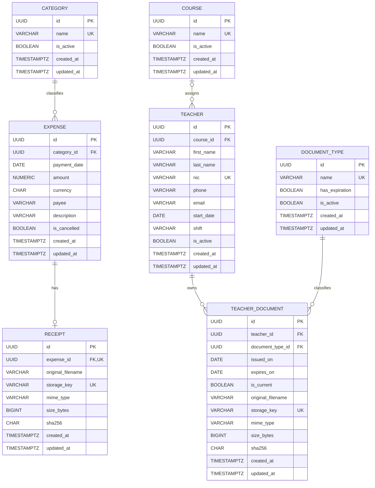

# KUME — Database design

This document defines the PostgreSQL data model for the KUME administrative prototype. Technical names use English, singular table names, and `snake_case` columns. User-managed values remain in Spanish.

## Entity-relationship diagram

## Column definitions

### `category`

| Column | PostgreSQL type | Null | Default | Rules |
|---|---|---:|---|---|
| `id` | `UUID` | No | Generated UUID | Primary key |
| `name` | `VARCHAR(100)` | No | — | Non-empty after trimming; case-insensitive unique value across active and inactive rows |
| `is_active` | `BOOLEAN` | No | `true` | Inactive categories remain available to historical expenses |
| `created_at` | `TIMESTAMPTZ` | No | `CURRENT_TIMESTAMP` | — |
| `updated_at` | `TIMESTAMPTZ` | No | `CURRENT_TIMESTAMP` | Maintained by a database trigger |

### `expense`

| Column | PostgreSQL type | Null | Default | Rules |
|---|---|---:|---|---|
| `id` | `UUID` | No | Generated UUID | Primary key |
| `category_id` | `UUID` | No | — | Foreign key to `category.id`; `ON DELETE RESTRICT` |
| `payment_date` | `DATE` | No | — | Determines the accounting period |
| `amount` | `NUMERIC(12,2)` | No | — | Must be greater than zero |
| `currency` | `CHAR(3)` | No | `'UYU'` | Three uppercase letters; the prototype API accepts only `UYU` |
| `payee` | `VARCHAR(200)` | No | — | Non-empty after trimming |
| `description` | `VARCHAR(500)` | No | — | Non-empty after trimming |
| `is_cancelled` | `BOOLEAN` | No | `false` | Cancelled expenses remain stored and do not contribute to totals |
| `created_at` | `TIMESTAMPTZ` | No | `CURRENT_TIMESTAMP` | — |
| `updated_at` | `TIMESTAMPTZ` | No | `CURRENT_TIMESTAMP` | Maintained by a database trigger |

### `receipt`

| Column | PostgreSQL type | Null | Default | Rules |
|---|---|---:|---|---|
| `id` | `UUID` | No | Generated UUID | Primary key |
| `expense_id` | `UUID` | No | — | Unique foreign key to `expense.id`; `ON DELETE RESTRICT` |
| `original_filename` | `VARCHAR(255)` | No | — | Display value only; never used as a filesystem path |
| `storage_key` | `VARCHAR(255)` | No | — | Unique opaque key relative to the configured storage root |
| `mime_type` | `VARCHAR(50)` | No | — | `application/pdf`, `image/jpeg`, or `image/png` |
| `size_bytes` | `BIGINT` | No | — | Between 1 and 10,485,760 bytes |
| `sha256` | `CHAR(64)` | No | — | Lowercase hexadecimal digest; intentionally not unique |
| `created_at` | `TIMESTAMPTZ` | No | `CURRENT_TIMESTAMP` | — |
| `updated_at` | `TIMESTAMPTZ` | No | `CURRENT_TIMESTAMP` | Maintained by a database trigger |

The database permits an `expense` without a `receipt`; the API must require one when creating a valid expense. Replacing a receipt updates the same row rather than creating a version history.

### `course`

| Column | PostgreSQL type | Null | Default | Rules |
|---|---|---:|---|---|
| `id` | `UUID` | No | Generated UUID | Primary key |
| `name` | `VARCHAR(100)` | No | — | Non-empty after trimming; case-insensitive unique value across active and inactive rows |
| `is_active` | `BOOLEAN` | No | `true` | Inactive courses cannot receive new assignments |
| `created_at` | `TIMESTAMPTZ` | No | `CURRENT_TIMESTAMP` | — |
| `updated_at` | `TIMESTAMPTZ` | No | `CURRENT_TIMESTAMP` | Maintained by a database trigger |

### `teacher`

| Column | PostgreSQL type | Null | Default | Rules |
|---|---|---:|---|---|
| `id` | `UUID` | No | Generated UUID | Primary key |
| `course_id` | `UUID` | Yes | — | Foreign key to `course.id`; `ON DELETE RESTRICT` |
| `first_name` | `VARCHAR(100)` | No | — | Non-empty after trimming |
| `last_name` | `VARCHAR(100)` | No | — | Non-empty after trimming |
| `nic` | `VARCHAR(20)` | No | — | Unique normalized identity value without dots, hyphens, or spaces |
| `phone` | `VARCHAR(30)` | Yes | — | — |
| `email` | `VARCHAR(254)` | Yes | — | — |
| `start_date` | `DATE` | Yes | — | — |
| `shift` | `VARCHAR(20)` | Yes | — | The API accepts only `morning` or `afternoon`; the database does not constrain its values |
| `is_active` | `BOOLEAN` | No | `true` | Teachers are deactivated, not deleted |
| `created_at` | `TIMESTAMPTZ` | No | `CURRENT_TIMESTAMP` | — |
| `updated_at` | `TIMESTAMPTZ` | No | `CURRENT_TIMESTAMP` | Maintained by a database trigger |

`course_id` and `shift` must either both be present or both be null. A unique constraint on `(course_id, shift)` prevents two teachers from occupying the same course and shift. No assignment history is retained.

### `document_type`

| Column | PostgreSQL type | Null | Default | Rules |
|---|---|---:|---|---|
| `id` | `UUID` | No | Generated UUID | Primary key |
| `name` | `VARCHAR(100)` | No | — | Non-empty after trimming; case-insensitive unique value across active and inactive rows |
| `has_expiration` | `BOOLEAN` | No | `false` | Controls API validation for `expires_on` |
| `is_active` | `BOOLEAN` | No | `true` | Inactive types remain attached to existing documents |
| `created_at` | `TIMESTAMPTZ` | No | `CURRENT_TIMESTAMP` | — |
| `updated_at` | `TIMESTAMPTZ` | No | `CURRENT_TIMESTAMP` | Maintained by a database trigger |

The initial row is named **“Certificado de manipulación de alimentos”**. Document type names are user-facing data and remain in Spanish.

### `teacher_document`

| Column | PostgreSQL type | Null | Default | Rules |
|---|---|---:|---|---|
| `id` | `UUID` | No | Generated UUID | Primary key |
| `teacher_id` | `UUID` | No | — | Foreign key to `teacher.id`; `ON DELETE RESTRICT` |
| `document_type_id` | `UUID` | No | — | Foreign key to `document_type.id`; `ON DELETE RESTRICT` |
| `issued_on` | `DATE` | Yes | — | — |
| `expires_on` | `DATE` | Yes | — | Required by the API when the selected type has expiration |
| `is_current` | `BOOLEAN` | No | `true` | At most one current document per teacher and document type |
| `original_filename` | `VARCHAR(255)` | No | — | Display value only; never used as a filesystem path |
| `storage_key` | `VARCHAR(255)` | No | — | Unique opaque key relative to the configured storage root |
| `mime_type` | `VARCHAR(50)` | No | — | `application/pdf`, `image/jpeg`, or `image/png` |
| `size_bytes` | `BIGINT` | No | — | Between 1 and 10,485,760 bytes |
| `sha256` | `CHAR(64)` | No | — | Lowercase hexadecimal digest; intentionally not unique |
| `created_at` | `TIMESTAMPTZ` | No | `CURRENT_TIMESTAMP` | — |
| `updated_at` | `TIMESTAMPTZ` | No | `CURRENT_TIMESTAMP` | Maintained by a database trigger |

A partial unique index on `(teacher_id, document_type_id) WHERE is_current` enforces a single current document. Renewing documentation creates a row and marks the previous row as not current. Correcting a mistaken upload updates the same row. A document uploaded by mistake may be physically deleted, including its stored file.

## Database constraints and indexes

The migration must implement constraints that Mermaid cannot express fully:

- Case-insensitive unique indexes on `lower(trim(name))` for `category`, `course`, and `document_type`.
- Non-empty checks after trimming for names, `expense.payee`, `expense.description`, and teacher names.
- `expense.amount > 0` and a three-uppercase-letter format for `expense.currency`.
- Allowed MIME types, byte-size range, and lowercase 64-character hexadecimal format for both file tables.
- A paired-nullability check for `teacher.course_id` and `teacher.shift`.
- Unique `(teacher.course_id, teacher.shift)` and the partial unique current-document index described above.
- `ON DELETE RESTRICT` for every foreign key; no cascading deletes.
- A shared trigger function that refreshes `updated_at` on every update.

## API-owned rules

The API, rather than the database, owns these rules:

- Require a receipt when creating a valid expense.
- Reject future `payment_date` values and currencies other than `UYU` in this version.
- Allow inactive categories on their existing expenses, but not on new expenses or as a replacement category.
- Validate the actual file signature as well as its declared MIME type and extension.
- Accept only `morning` and `afternoon` for `teacher.shift`.
- Clear `course_id` and `shift` when a teacher is deactivated.
- Prevent deactivating a course while it is assigned to an active teacher.
- Require `teacher_document.expires_on` when its `document_type.has_expiration` is true.
- Normalize `teacher.nic` before checking uniqueness.
- Keep CLOCK integration outside this version.

## File storage

- Store file contents outside PostgreSQL in a persistent Docker volume.
- Store only an opaque relative `storage_key`; never persist host-specific absolute paths.
- Preserve `original_filename` only for display and downloads.
- On replacement, write and validate the new file first, update the database transaction, and delete the previous file only after the transaction commits.
- If the database operation fails, remove the newly staged file. If post-commit cleanup fails, report it and leave the old unreferenced file available for later cleanup rather than risking the current file.
- Backups and restorations must treat the PostgreSQL data and the file volume as one versioned unit.
