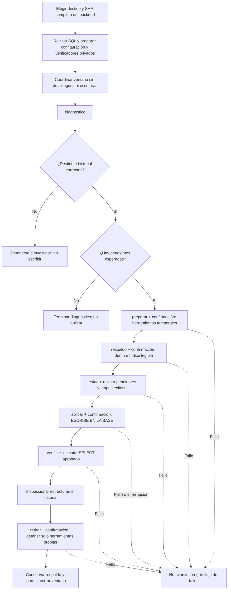
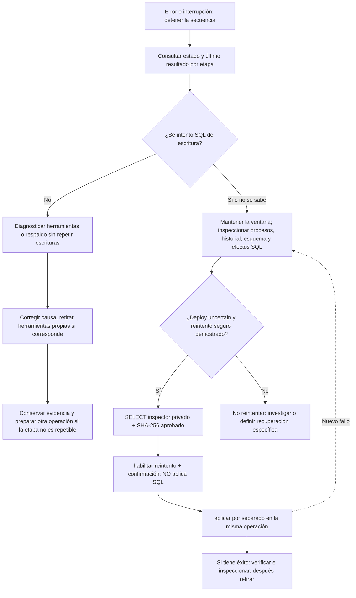

# Migraciones de base con kume-admin

Estado al 9 de noviembre de 2026: instalada y utilizada en Oracle durante la sesión
guiada, según resultados aportados por Maxi. Reportó la aplicación, verificación y
retirada de herramientas de `payment-records-002` después de corregir npm y UID/GID.
No es una inspección remota desde Codex ni una restauración comprobada. La
[spec 002](../specs/002-admin-migrations/spec.md) y su
[diseño](../specs/002-admin-migrations/technical-spec.md) definen esta ampliación.
Oracle es el host; la base sigue siendo PostgreSQL. Consultas anteriores conservan
su contrato de lectura. Ninguna migración se ejecuta al abrir el menú.

Ir a: [recorrido y diagramas](#uso-autónomo-recorrido-del-operador),
[configuración](#configuración-privada), [comandos por etapa](#etapas-explícitas),
[inspección de tablas](#inspeccionar-estructuras-e-historial) o
[recuperación por inspección](#uidgid-operativo-y-recuperación-por-inspección).

## Uso autónomo: recorrido del operador

Esta guía permite operar desde la terminal sin un agente. El operador elige y
aprueba destino, revisión y SQL; ejecuta una etapa por vez y revisa su resultado.
Los comandos no generan migraciones nuevas: aplican los archivos ya versionados
en el backend. El menú solo abre ayuda; las etapas se invocan por CLI.

### Flujo habitual



| Etapa | Qué hace | Cuándo avanzar |
|---|---|---|
| `diagnostico` | Comprueba destino, recursos, código e historia; muestra pendientes. | Solo aparecen los SQL revisados y esperados. Si no hay pendientes, terminar. |
| `preparar` | Crea herramientas temporales y snapshot privado; comprueba acceso con UID/GID operativo. | Muestra `Etapa completada: preparar`. |
| `respaldo` | Genera dump CUSTOM, lee su índice y registra checksum. | Muestra `Etapa completada: respaldo`. No significa restauración probada. |
| `estado` | Revisa pendientes e informa etapas registradas. | Preparar y respaldo terminaron con éxito; pendientes siguen siendo las aprobadas. |
| `aplicar` | Revalida respaldo/destino y ejecuta `prisma migrate deploy`, historia y verificador. | Muestra `Etapa completada: aplicar`. Un error puede haber dejado efectos. |
| `verificar` | Repite el SELECT de verificación aprobado. | Muestra `Etapa completada: verificar` y la inspección complementaria coincide. |
| `retirar` | Detiene el contenedor de esta operación, conservando sus archivos. | Muestra `Etapa completada: retirar`. |

Si una etapa falla, no continuar con la siguiente ni cambiar el ID para evitar
el error. Los `running` anteriores seguidos de `success` de la misma etapa son
historia normal: interpretar el último resultado de cada acción. Un último
`running` o `uncertain` exige inspección; no significa que el SQL se revirtió.

### Qué preparar para cada nueva migración

1. Verificar instalación completa y versión revisada del motor. Las versiones
   anteriores a la corrección `170d15e1d1b3dc0bc8372caf9675fe58b631ba0a` no
   corrigen el acceso del UID operativo al snapshot privado.
2. Revalidar host, usuario, estados, contenedores, red y conexión filtrada. Usar
   `kume-admin estados`, `memoria` y `contenedores`; el diagnóstico repite controles
   automáticos. No exponer `runtime.env` ni usar `docker inspect` completo.
3. Elegir un SHA backend completo, revisar **todos** sus SQL pendientes y disponer
   de un checkout limpio separado de releases. Un checkout de una migración anterior
   no incorpora automáticamente migraciones nuevas. No actualizar el producto.
4. Crear una configuración JSON nueva según [Configuración privada](#configuración-privada),
   con el destino actual y esa revisión. Preparar un verificador específico para
   el resultado esperado, guardarlo privado y calcular su SHA-256. Para el flujo
   normal, los campos `initial_*` siguen siendo obligatorios pero no habilitan
   inicialización; ambos verificadores pueden apuntar al mismo archivo final.
5. Elegir un ID nuevo para esta operación, conservándolo entre todas sus etapas.
   No modificar su JSON o archivos aprobados a mitad del proceso. Una corrección
   de un deploy incierto se trata en la misma operación mediante inspección.
6. Coordinar y mantener la ventana de mantenimiento. El motor toma locks por
   invocación; entre etapas no conserva el lock. Los actores que lo ignoran deben
   coordinarse externamente durante toda la operación.

No reutilizar a ciegas el verificador de `payment-records-002`: exigía cero gastos
/comprobantes y cantidades de catálogos observadas en esa sesión. Tras empezar a
usar la aplicación esas condiciones pueden dejar de ser válidas. El verificador
siguiente debe comprobar la nueva migración y la conservación de datos actuales.

### Cómo responder a una confirmación

El proceso tiene dos entradas diferentes:

1. En el prompt Bash `ubuntu@host:~$`, ejecutar el comando `kume-admin migraciones ...`.
2. Cuando el programa muestre `Confirmá escribiendo exactamente:`, pegar allí la
   frase que generó y presionar Enter. Revisar acción, host, base, revisión y respaldo
   antes de hacerlo. Confirmar `ventana-coordinada` solo si esa ventana existe.
3. Esperar el resultado de la etapa y el regreso al prompt Bash antes del comando siguiente.

La frase **no es un comando Bash**. Si aparece `-bash: preparar: command not found`,
se la escribió fuera del programa y esa línea no preparó herramientas. Si se canceló
antes de registrar la intención, puede volver a abrirse esa etapa; si hay una etapa
previa registrada, inspeccionar su resultado antes de repetirla.

### Por qué se hacen estas validaciones

| Control | Qué evita o demuestra |
|---|---|
| Host, conexión, identidad física y revisión | Aplicar SQL a otra base o usar otro código; detecta cambios de destino entre etapas. |
| Checksums de archivos e historial | Usar una migración modificada o una historia divergente. |
| Recursos, permisos y acceso UID/GID | Fallar por falta de capacidad o porque Prisma no puede leer su snapshot. |
| Dump e índice legible | Tener una copia previa identificada; no demuestra restauración completa. |
| Locks, estados y ventana | Excluir operaciones cooperantes y coordinar las restantes; mirar `pending` una vez no elimina carreras. |
| Revalidación después de confirmar | Detectar cambios ocurridos mientras el operador revisaba el resumen. |
| Verificación final e inspección | Comprobar historia, estructura y efectos esperados del SQL específico. |
| Inspección antes de reintentar | Evitar repetir SQL parcialmente ejecutado o marcar como aplicado algo pendiente. |

Las consultas manuales ayudan a investigar y aprobar el destino; no hace falta
repetir todas en cada etapa. El motor repite sus comprobaciones en los puntos donde
el estado puede haber cambiado. Una confirmación no sustituye esos controles.

### Si algo falla



`habilitar-reintento` solo sirve para un deploy cuyo último resultado sea
`uncertain`, con preparación correcta y respaldo intacto. Requiere una inspección
concluyente, no un SELECT trivial. Si el historial ya está completo, hay efectos
parciales, sigue un migrador activo, el último estado es `running` o intervino
`inicializar`/`resolve`, detenerse y definir la recuperación correspondiente.
La herramienta no ofrece reparación universal para esos casos. Un fallo de lectura
posterior al deploy tampoco autoriza repetir SQL que ya figura aplicado.

El procedimiento de recuperación soportado y sus argumentos están en
[UID/GID operativo y recuperación por inspección](#uidgid-operativo-y-recuperación-por-inspección).
La [inicialización excepcional](#inicialización-excepcional) es una rama distinta;
una base con tablas no es motivo suficiente para elegirla.

## Antes de operar

El operador responsable debe aprobar el destino y los SQL concretos de la operación.
El permiso para desarrollar o publicar la herramienta no autoriza otras bases ni
futuros despliegues. Revalidar host, usuario, estados,
backend, PostgreSQL, red y recursos; los nombres/SHA de la sesión histórica no
son descubrimiento del entorno actual. Ejecutar como usuario operativo, sin sudo
global. Python 3.9+, Git, Docker, sudo ya autorizado, Bash y acceso SSH configurado.
La utilidad no crea claves, acepta hosts desconocidos, clona, instala paquetes en
el host ni modifica permisos del repositorio. Si falta acceso, detenerse.

Preparar por separado un checkout limpio de un SHA completo aprobado del backend,
con origin SSH configurado; conservar cualquier checkout con cambios. No usar una
release activa. El paquete prisma del package.json debe fijar exactamente 6.19.0.
No se actualiza por avisos. Se extraen de Git los archivos Prisma al snapshot de
la operación; no se ejecutan scripts de ese checkout. Revisar schema, SQL y
checksums antes de aprobar. El origen declarado no prueba la firma o aprobación
del commit: esa revisión es responsabilidad del operador.

Coordinar una ventana sin despliegues ni escrituras de usuarios. Verificar qué
workflows instalados respetan realmente el deployment.lock del backend. El motor
lo toma exclusivo y no bloqueante, junto con su lock global, y rechaza pending;
no coordina pipelines/manuales que ignoren ese lock. No basta con mirar pending
una vez. Suspender externamente esos actores y mantener la ventana hasta terminar;
la frase de confirmación registra la declaración del operador, no la verifica.
No se detienen servicios ni se cambian permisos automáticamente.

## Configuración privada

Crear fuera del checkout un JSON de propietario operativo y modo 0600. El ejemplo
es ficticio; sustituir cada destino después de inspeccionarlo. No incluir URL de
base, contraseña, token, valores de runtime.env o claves. Rutas absolutas canónicas,
sin enlaces simbólicos en los archivos privados. El lock debe existir junto al
estado backend; no crearlo para evitar un error.

```json
{
  "host": "vm-fixture",
  "backend": "fixture-api-1",
  "postgres": "fixture-db-1",
  "network": "fixture_default",
  "server": "db",
  "port": "5432",
  "database": "fixture",
  "user": "fixture",
  "revision": "aaaaaaaaaaaaaaaaaaaaaaaaaaaaaaaaaaaaaaaa",
  "repository": "git@github.com:example/fixture-backend.git",
  "checkout": "/home/operator/fixture-migrations",
  "runtime_env": "/home/operator/fixture-backend/shared/runtime.env",
  "backend_state": "/home/operator/fixture-backend/state.json",
  "frontend_state": "/home/operator/.local/share/fixture-frontend/state.json",
  "webroot": "/srv/fixture-frontend",
  "deployment_lock": "/home/operator/fixture-backend/deployment.lock",
  "verification_sql": "/home/operator/final-verification.sql",
  "verification_sha256": "bbbbbbbbbbbbbbbbbbbbbbbbbbbbbbbbbbbbbbbbbbbbbbbbbbbbbbbbbbbbbbbb",
  "initial_verification_sql": "/home/operator/schema-verification.sql",
  "initial_verification_sha256": "cccccccccccccccccccccccccccccccccccccccccccccccccccccccccccccccc",
  "initial_migration": "202601010001_schema"
}
```

Los dos verificadores son archivos locales privados, revisados y aprobados por
SHA-256. Cada uno contiene un único SELECT que devuelve solamente la fila `ok`
si cumple todas sus condiciones; cualquier otro resultado falla. No usar el
trivial SELECT 'ok' como prueba de un esquema. El inicial comprueba estructura,
columnas, defaults, restricciones, índices, triggers y conservación de las tablas
previas según el SQL específico. El final comprueba historia y datos esperados
según [alcance](../functional/alcance-prototipo.md) y
[base](../technical/backend/database-design.md), sin duplicar esos valores en el
administrador. Se ejecutan en transacción READ ONLY con PGOPTIONS; no admiten
metacomandos ni varias sentencias. No usar funciones con efectos externos.
Son código aprobado, no una entrada SQL no confiable.

El motor admite Node 18/20/22/24 y npm 9/10/11 como candidatos; la ejecución efectiva
de Prisma debe confirmar compatibilidad. Resuelve la imagen local desde backend,
verifica que tenga Node/npm y exige RAM disponible mínima de 512 MiB y 1 GiB libre,
además de espacio para dos veces el tamaño actual de base más 256 MiB. Estos umbrales
son conservadores, no aseguran ausencia de OOM. No crea swap. Instala Prisma
6.19.0 exclusivamente en /tmp del contenedor, con install scripts deshabilitados;
detecta approve-scripts mediante npm --help y, si está disponible, aprueba solamente
prisma y @prisma/engines. Para npm previo usa rebuild explícito de ambos paquetes.
Un fallo de capacidades/versiones aborta; no instala otra versión como alternativa.

## Etapas explícitas

Usar un ID nuevo por operación, conservar el mismo ID y el mismo JSON entre etapas.
Los comandos siguientes son una secuencia de referencia: ejecutar uno por vez y
revisar su resultado antes del siguiente, con el destino y los SQL ya aprobados.
Las rutas e ID de ejemplo se reemplazan por los propios; no pegar el bloque entero
ni encadenar las etapas. No hace falta que un agente valide cada salida si el
operador puede comprobar los criterios del recorrido anterior.

```bash
kume-admin migraciones --help
kume-admin migraciones diagnostico --config /ruta/privada/destino.json --operacion cambio-001
kume-admin migraciones preparar --config /ruta/privada/destino.json --operacion cambio-001
kume-admin migraciones respaldo --config /ruta/privada/destino.json --operacion cambio-001
kume-admin migraciones estado --config /ruta/privada/destino.json --operacion cambio-001
kume-admin migraciones aplicar --config /ruta/privada/destino.json --operacion cambio-001
kume-admin migraciones verificar --config /ruta/privada/destino.json --operacion cambio-001
kume-admin migraciones retirar --config /ruta/privada/destino.json --operacion cambio-001
```

Diagnóstico/estado inspeccionan identidad, fuentes, tablas e historia SQL; no crean
herramientas ni aplican SQL. Crean solo el directorio local operativo y sus locks.
Muestran pendientes comparando nombres/checksums/finalización del historial con el
commit aprobado; una migración fallida, revertida o divergente exige investigación.
No se usa el código 1 de Prisma migrate status como sinónimo universal de pendientes.

Preparar solicita confirmación y crea un contenedor temporal --rm, --pull=never,
384 MiB de RAM y swap total limitado a lo mismo, sin puertos ni socket Docker.
Recibe runtime.env sin imprimirlo y monta el snapshot Prisma readonly. La conexión
se parsea dentro de backend y herramientas, mostrando solo identidad aprobada;
DNS debe coincidir con la IP de PostgreSQL en la red configurada. Esta entrega
admite únicamente el esquema public y rechaza el parámetro de conexión options.
Conserva IDs de contenedores, releases y system_identifier de PostgreSQL: un cambio
entre etapas bloquea la operación. El usuario SQL necesita poder leer pg_control_system;
si no puede, falla sin conceder privilegios.

Respaldo crea pre-migration.dump con modo 0600 y creación exclusiva. Valida tamaño,
índice con pg_restore --list y SHA-256. **No prueba restauración**, no incluye archivos
del producto ni sustituye copias cifradas externas. Un dump parcial queda conservado
como evidencia fallida y nunca habilita escrituras.

Aplicar exige respaldo intacto, historia coherente, confirmación literal con
acción/host/base/revisión/ventana y revalidación antes de migrate deploy. Comprueba
historia completa y verificador final. Si no hay pendientes en una segunda llamada
tras éxito, informa sin volver a escribir. Una base pública no vacía sin historial
no entra en deploy automático. Los datos de carga inicial provienen de las migraciones.

## Inspeccionar estructuras e historial

Estas consultas son de solo lectura. Revisar estructura no demuestra funcionamiento
de la aplicación, almacenamiento de comprobantes o restauración. Los nombres de
contenedor/base/usuario siguientes corresponden al destino de la sesión de pagos;
revalidarlos para otra máquina.

### Columnas, tipos, obligatoriedad y defaults

Ejecutar en una sesión SQL conectada a la base destino:

```sql
SELECT c.relname AS tabla,
       a.attname AS columna,
       pg_catalog.format_type(a.atttypid, a.atttypmod) AS tipo,
       a.attnotnull AS obligatoria,
       pg_catalog.pg_get_expr(d.adbin, d.adrelid) AS valor_inicial
FROM pg_catalog.pg_class AS c
JOIN pg_catalog.pg_namespace AS n ON n.oid = c.relnamespace
JOIN pg_catalog.pg_attribute AS a ON a.attrelid = c.oid
LEFT JOIN pg_catalog.pg_attrdef AS d
       ON d.adrelid = c.oid AND d.adnum = a.attnum
WHERE n.nspname = 'public'
  AND c.relkind IN ('r', 'p')
  AND c.relname IN ('category', 'expense', 'receipt')
  AND a.attnum > 0 AND NOT a.attisdropped
ORDER BY c.relname, a.attnum;
```

Deben aparecer las tres tablas. Comparar las definiciones contra el SQL del commit
aprobado; esta consulta no verifica constraints, índices ni triggers.

### Estructura completa desde la terminal de Oracle

Para ver también PK, FK, CHECK, índices y triggers, psql ofrece el metacomando
`\d+`. No es SQL estándar ni forma parte de los archivos SELECT verificadores:

```bash
sudo docker exec kume-infra-test-db-1 psql -X -v ON_ERROR_STOP=1 -U kume_test -d kume_test \
  -c '\d+ public.category' \
  -c '\d+ public.expense' \
  -c '\d+ public.receipt'
```

Contrastar la salida con migration.sql. Para pagos, revisar particularmente las
FK restrictivas, unicidad de rubro normalizado, comprobante por gasto y storage_key,
los checks y los tres triggers de updated_at. La especificación de columnas y reglas
permanece en el [diseño de base](../technical/backend/database-design.md).

### Comprobar el registro de Prisma

```sql
SELECT migration_name, checksum,
       finished_at IS NOT NULL AS terminada,
       rolled_back_at IS NOT NULL AS revertida,
       applied_steps_count
FROM public._prisma_migrations
WHERE migration_name = '20261108170000_payment_records'
ORDER BY started_at, id;
```

Para la operación de pagos completada se espera una fila con `terminada=true`,
`revertida=false` y el checksum del migration.sql aprobado:
`3f5d83a3c41a9c04328fa9d55fc16f3364e0e87395fa24bab8e9b8ceacc9a7b4`.
Cero filas, filas duplicadas, checksum distinto o ausencia de finalización requieren
investigar; no se corrigen marcando resolve ni editando el historial. Para futuras
migraciones sustituir el nombre y comparar con su propio checksum, no con este valor.

El verificador aprobado y `kume-admin migraciones estado` complementan estas
consultas. No hace falta recrear un contenedor temporal retirado para usar psql.

## Inicialización excepcional

Solo para una base preexistente cuyo estado haya sido inspeccionado y aprobado,
sin ninguna fila de historial y con primera migración explícita. No generalizar
la conservación de infrastructure_check de la sesión histórica a otras bases.

Después de preparar y respaldar, usar `inicializar` en lugar de aplicar. Confirma
nombre/checksum y ejecuta exactamente el archivo SQL de la primera migración;
comprueba el verificador inicial. Luego `verificar` repite ese verificador y guarda
su evidencia posterior al SQL. Solo entonces `registrar-inicializacion` pide otra
confirmación, repite la verificación y ejecuta resolve --applied para esa primera
migración. Después `aplicar` despliega el resto y usa el verificador final.
No se registra una migración para saltear SQL pendiente, fallos o divergencias.

## Evidencias, interrupción y limpieza

Registros en ~/.local/share/kume-admin/migrations/OPERACION/journal.json, directorios
0700 y archivos 0600: destino, revisión, versiones, snapshot y checksums, contenedor,
respaldo, etapas/fecha/código y resultados. Sin salida bruta de npm/Prisma/SQL ni secrets.
Los códigos positivos de colaboradores se conservan; cancelación/interrupción: 130;
lock ocupado: 75; uso inválido: 2; validación: 1; timeout: 124.

Una intención `running` puede haber ejecutado SQL incluso sin respuesta. Un fallo
de escritura se registra `uncertain`, conservando código. SIGINT/SIGTERM registran
interrupción cuando es posible; SIGKILL puede dejar running. El proceso remoto puede
seguir vivo tras timeout o pérdida de conexión. No reintentar SQL ni asumir rollback.
Inspeccionar historial, esquema, datos y proceso remoto durante la ventana.
Otra operación con escritura incierta bloquea nuevas escrituras, incluso con otro ID.

Si la inicialización quedó entre SQL y resolve, no se repite db execute. Inspeccionar
manualmente efectos completos; solo si el verificador inicial aprobado confirma todo,
`verificar` y `registrar-inicializacion` permiten continuar en el mismo ID. Si falla,
se requiere recuperación manual autorizada. Un resolve o deploy incierto se investiga
manualmente; la utilidad no ofrece un botón para borrar la incertidumbre. No editar
journal para forzar escrituras: conservar evidencia y documentar una decisión de
recuperación separada antes de cualquier intervención.

`retirar` funciona aun si falló la preparación. Detiene únicamente el ID cuyo label
kume.migration coincida con la operación; si se interrumpió antes de persistir el ID,
resuelve el nombre registrado y exige ese mismo label. No usa rm genérico, prune,
reset, db push, down -v, reinicios ajenos ni borrado de checkout/respaldo. No retira
automáticamente el contenedor ante fallo: queda disponible para inspección y retirada
explícita. Si ya no existe, informa fallo sin tocar otros contenedores.

No restaura ni ejecuta workflows. El despliegue backend y luego frontend de la sesión
histórica seguían pendientes: el SQL aplicado no acredita esos despliegues.
Para revertir la utilidad, recuperar su versión anterior conservada; eso no revierte
la base. Restauración y corrección de datos requieren autorización y plan propios.

## Instalación de esta ampliación

La instalación histórica de un único archivo conserva sus checksums y evidencia en
[administración](administracion-oracle.md). Esta versión necesita oracle-admin.sh,
oracle-migrations.py y el paquete kume_migrations juntos en el mismo directorio.
Preparar una carpeta versionada privada con todos esos archivos de un commit revisado,
validar los SHA-256 de cada archivo y ejecutar allí sintaxis, suite y ambas ayudas.
Conservar la instalación anterior antes de cambiar el comando de entrada. No usar el
checksum histórico para estos archivos ni mezclar revisiones del paquete y dispatcher.
En la sesión guiada, Maxi confirmó el comando corto apuntando al checkout completo
y fijó la revisión correctora `170d15e1d1b3dc0bc8372caf9675fe58b631ba0a`.
Una actualización futura requiere revisar y fijar su propia revisión completa;
modificar main en GitHub no actualiza automáticamente ese checkout de la VM.

Procedimiento específico: [tablas de gastos y comprobantes](migraciones-payment-records.md).

## Compatibilidad con la ayuda de npm 11.17

npm 11.17 puede devolver código 1 aun cuando imprime ayuda válida. El motor admite
0/1 exclusivamente en ese sondeo de lectura y exige reconocer `npm <command>` y los
comandos install/rebuild; cualquier otra respuesta detiene la preparación. Los
códigos no cero de install, approve-scripts y rebuild siguen siendo errores.

Una versión anterior puede haber detenido preparar después de install por esa
respuesta de ayuda. No editar el journal para marcar éxito: conservar la evidencia,
retirar el contenedor propio mediante retirar, actualizar la distribución completa
y preparar una operación nueva tras diagnosticar el fallo. Esta recuperación de
herramientas no autoriza repetir SQL ni borrar journals de escrituras inciertas.

## UID/GID operativo y recuperación por inspección

Los snapshots siguen privados (directorios 0700 y archivos 0600). El contenedor
nuevo usa --user UID:GID del operador, con HOME=/tmp/kume-prisma-home. El bind
permanece readonly. No se cambia el usuario del backend/PostgreSQL ni se conceden
permisos a otros usuarios. También cada docker exec de Prisma fija ese UID/GID y
HOME: permite usar herramientas de un contenedor propio creado por la versión
anterior. Antes de instalar o ejecutar Prisma se comprueba lectura de todos los
archivos del snapshot bajo ese usuario y se registra tool_exec_user. Un fallo de
acceso bloquea la escritura antes de registrar intención SQL.

Para un deploy previo incierto, arreglar permisos no basta para repetirlo. Se
incorpora habilitar-reintento, que solo habilita el siguiente intento en la misma
operación; no ejecuta migrate deploy. No aplica a db execute/resolve excepcionales.

1. Mantener la ventana coordinada y comprobar que no sigue un proceso migrador.
2. Inspeccionar el historial, esquema y efectos posibles de TODOS los SQL pendientes
   del commit aprobado. La ausencia de una fila del historial por sí sola no prueba
   ausencia de efectos. Resolver cualquier aplicación parcial antes de continuar;
   este paso no es un mecanismo para saltear SQL pendiente ni errores del esquema.
3. Preparar un archivo SQL privado revisado, de un único SELECT, que devuelva solo
   ok si el destino está en condiciones de volver a ejecutar los SQL pendientes.
   Debe verificar los efectos posibles de la migración particular, no solo contar
   tablas. No usar SELECT 'ok' sin condiciones ni funciones con efectos externos.
4. Calcular su SHA-256 y ejecutar habilitar-reintento con --config, --operacion,
   --inspeccion-sql RUTA_ABSOLUTA y --inspeccion-sha256 HASH. El motor comprueba
   identidad, fuente, respaldo, historia no divergente y el SELECT READ ONLY.
5. Confirmar específicamente habilitar-reintento con destino/revisión/ventana. Se
   repiten las comprobaciones y se agrega la evidencia al journal. El evento
   aplicar=uncertain original permanece intacto; no se lo transforma en éxito.
6. Ejecutar aplicar por separado en la misma operación. El motor vuelve a comprobar
   el hash y el resultado del inspector antes de SQL. La autorización queda ligada
   al intento incierto y a los pendientes inspeccionados: un nuevo intento fallido
   la consume y exige otra investigación. Otras operaciones siguen bloqueadas
   mientras esa escritura permanezca incierta, aunque haya autorización de reintento.

No editar/borrar journals ni cambiar el ID para eludir incertidumbre. El inspector
es código aprobado por el operador, igual que el verificador final; la herramienta
no puede deducir por sí sola la semántica de cualquier migración ni dar por probada
la recuperación mediante un SELECT trivial. Una historia ya completa se verifica;
no necesita habilitar-reintento. Esta acción exige preparado=success y respaldo
intacto, además de una inspección manual concluyente de la causa original.
