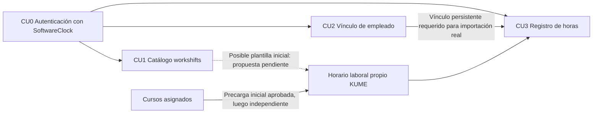

# SoftwareClock — Casos de uso y continuidad

Fecha: 23 de noviembre de 2026. Maxi solicita separar lo descubierto en tres casos de uso y preparar tres prompts para sesiones independientes. Documentación de diseño, no implementación. Las reglas Q1–Q31 permanecen aprobadas; las ampliaciones posteriores de catálogo/vinculación se distinguen de las propuestas todavía pendientes.

| Caso de uso | Fuente del caso | Continuación |
| --- | --- | --- |
| CU0 — Autenticación con SoftwareClock | [Caso de uso](autenticacion.md) | [Especificación y plan](../../specs/011-softwareclock-auth/plan.md) |
| CU1 — Sincronizar workshifts / catálogo de horarios laborales | [Caso de uso](sincronizar-horarios.md) | [Especificación y plan](../../specs/012-softwareclock-workshifts/plan.md) · [Prompt CU1](../../general/prompts/softwareclock/01-sincronizar-horarios.md) |
| CU2 — Sincronizar empleado con Clock | [Caso de uso](sincronizar-empleado.md) | [Prompt CU2](../../general/prompts/softwareclock/02-sincronizar-empleado.md) |
| CU3 — Registro de horas por empleado | [Caso de uso](registro-horas.md) | [Prompt CU3](../../general/prompts/softwareclock/03-registro-horas.md) |

## Fronteras y dependencias

CU1 importa referencias de turnos. CU2 vincula identidades. CU3 importa eventos y calcula trabajo respecto de un horario KUME. Sincronizar no significa escribir datos en Clock ni mantener herencia viva.

Orden sugerido: estudiar CU1 y CU2 en sesiones separadas; cerrar identidad y contrato de lectura de CU2 antes de importar marcas reales en CU3. CU1 no bloquea CU2 ni es requisito obligatorio de CU3. El cálculo local y pruebas con fixtures de CU3 pueden avanzar sin red.

CU0 define el mecanismo compartido de autenticación y lectura que CU1, CU2 y CU3 requieren para consultar Clock. El backend revisado contiene un cliente compartido. CU1 propone reutilizar esa instancia y deja documentado el estado de verificación en su [propuesta técnica](../../specs/012-softwareclock-workshifts/technical-spec.md). Coordinar nombres de recursos, versiones y cambios en documentos compartidos para evitar pisar trabajo de otras sesiones.

## Evidencia disponible

- Maxi habilitó API Software Clock y creó usuario API. Basic GET `/api/ClockApiUser` y Bearer GET de asistencias por fechas respondieron 200 en sus pruebas.
- Empleado anonimizado observado: `id`, `code`, `document`, nombres y referencia `workshiftCode`/`workShiftName`; no se dispone de garantía de unicidad/estabilidad ni de estructura exterior del listado.
- Catálogo getWorkShifts observado: array `code`/`name`/`type`, varios códigos vacíos; sin bloques/días/pausas/vigencias estructurados en esa respuesta.
- Asistencia ficticia observada: `code`, `document`, `issued`, `created` y metadatos; no incluye dirección entrada/salida en la muestra. Timestamp sin offset, identidad del evento y cobertura aún por validar.
- Los resultados provienen de Maxi y las muestras de conversación. El agente no ejecutó pruebas autenticadas ni dispuso de credenciales.

Fuente de detalles del proveedor: [hallazgos de API](../../technical/softwareclock-api.md). Diseño de mapeo y secuencias: [vinculación y turnos](../../technical/softwareclock-employee-mapping.md). Reglas Q1–Q31: [registro de horas](../registro-horas.md). Iniciativa de partida: [010-time-records](../../specs/010-time-records/spec.md), cuya propuesta técnica todavía no es contrato canónico.

## Estado y límites de continuación

Discovery funcional del registro de horas cerrado por Maxi. No se aprobaron automáticamente la identidad externa, nuevas rutas públicas, esquema/migraciones, importación como plantillas ni UI nueva de catálogo. Resolver esos puntos sobre propuestas concretas; no reabrir decisiones funcionales ya acordadas. Ninguna respuesta larga prueba cobertura completa o ausencia de paginación.

Los prompts continúan investigación acotada, especificación y diseño hasta dejar entregables revisables; no presuponen implementación autorizada de contratos aún no aprobados. Consultar AGENTS de cada repositorio. No guardar secretos/PII ni modificar producción. Commit/push/merge y despliegue se rigen por autorizaciones explícitas del trabajo, no por copiar un prompt.
