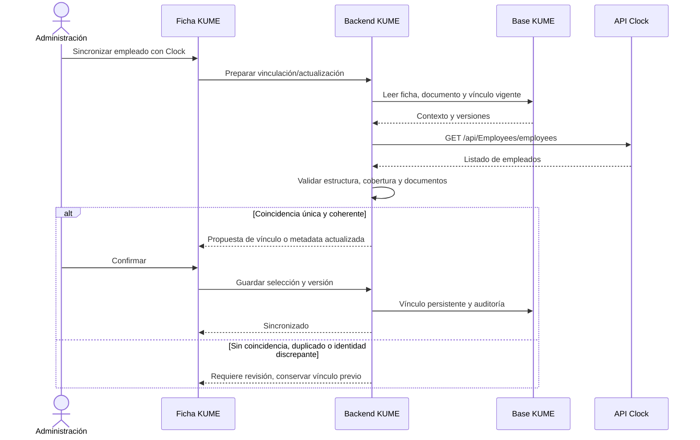

# CU2 — Sincronizar empleado con Clock

Fecha: 23/11/2026. Actor: administración. UX solicitada por Maxi: botón «Sincronizar empleado con Clock» en la ficha. Estado: intención y flujo general aceptados; contrato de vínculo, revalidación y persistencia detallados son propuestas sin implementación.

## Objetivo y endpoints

Persistir relación entre una ficha KUME y un empleado Clock, para que CU3 consulte marcas sin descubrir nuevamente al empleado en cada mes. Sincronizar identidad/metadata externa no significa importar todas las propiedades personales ni modificar horario laboral, cursos, roles o permisos.

- Basic GET `/api/ClockApiUser`: obtener token, probado por Maxi.
- Bearer GET `/api/Employees/employees`: consultar catálogo; muestra individual aportada por Maxi. Colección documenta branchName/groupName, cuya semántica/cobertura aún requiere validación.
- GET `/api/Employees/employee-by-rut?document=...`: alternativa documentada, no probada; no sustituir el listado solicitado sin evaluar su respuesta.
- CU3 usa `/api/Attendance/getAttendances?document=...&start=...&end=...`: el filtro document está documentado, pendiente de comprobar. No hay filtro por id de empleado demostrado.

Base comprobada: `https://api.portalempleado.softwareclock.com/`. Portal del Cliente devolvió 404 para el login de esta colección en la prueba anterior.

## Campos y correspondencia

| Campo externo observado | Uso propuesto |
| --- | --- |
| id | Identidad externa candidata; validar estabilidad y alcance por conexión/empresa |
| code | Código de empleado; no confundir con code de asistencia |
| document | Comparar cédula normalizada como texto y conservar documento externo exacto para consultar |
| firstName / lastName | Verificación visual; nunca identidad por nombre ni reemplazo silencioso de ficha |
| workshiftCode / workShiftName | Referencia informativa del turno; puede existir sin CU1 importado y no altera horario propio |
| external_id | Nulo en la muestra; no suponer que enlaza con UUID KUME ni escribir para poblarlo |
| groupName / labourerType | Contexto externo; no determina permisos, rol KUME o pagos |
| Fechas/contacto/dirección/flags/tags | Fuera del vínculo mínimo; no importar por defecto |

La muestra individual no revela envelope, paginación ni unicidad. registeredDate/birthday están en formato de presentación sin offset y no prueban fechas civiles compatibles con KUME. Documento nunca numérico: preservar ceros; no inventar dígito verificador a partir del ejemplo anonimizado.

## Secuencia propuesta

Propuesta de registro: ficha KUME, conexión/empresa, id y código externos diferenciados, documento exacto/normalizado, nombre externo de comprobación, referencias de turno, actor/fecha, versión y estado. Una ficha por vínculo vigente y un empleado por ficha dentro del alcance de conexión, una vez validada identidad; comprobar concurrencia con constraints/transacciones.

La primera asociación se propone por documento único y se confirma, nunca por similitud de nombres. Una resincro de vínculo existente conserva su identidad y solo actualiza metadata admitida; discrepancia exige revisión. Cambiar cédula no reasigna importaciones históricas. Resultado vacío o listado incompleto no prueba que empleado dejó de existir. No crear fichas nuevas ni borrar las existentes automáticamente.

## Dependencias y pendientes

No requiere que CU1 esté implementado; preservar referencia externa de turno como metadata incluso sin correspondencia local. Exportar a CU3 una lectura del vínculo validado y documento de consulta; no mezclar IDs externos con UUIDs KUME ni exponer secretos.

Pendientes: listado completo/envelope, filtro y estabilidad id/code, identidad por empresa, cambio de documento, actualización parcial/revinculación, estados de UI, política de confirmación y versiones de vínculo/ficha. Son propuestas técnicas a cerrar sobre evidencia; no marcar comprobado el filtro de asistencias por recibir empleados.

Criterios de salida: vínculo persistente único y auditado, caso de documento sin coincidencia/duplicado, reimportación sin nuevo descubrimiento mensual, cambio de identidad seguro y errores que no destruyen vínculo. Pruebas con documentos ficticios y sesiones autorizadas; ninguna llamada de escritura a Clock.

[Prompt de esta sesión](../../general/prompts/softwareclock/02-sincronizar-empleado.md). [Índice](README.md). [Detalle de mapeo y secuencias](../../technical/softwareclock-employee-mapping.md).
