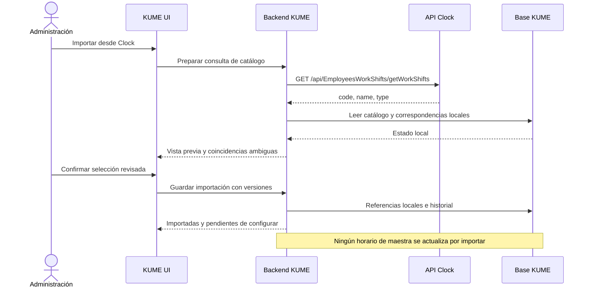

# CU1 — Sincronizar workshifts / horarios laborales

Fecha: 23/11/2026. Actor: administración. Entrada UX solicitada por Maxi: Administración → Horarios laborales → Importar desde Clock. Estado: caso identificado y solicitud de importación aprobada; diseño detallado de UI, correspondencia y uso como plantillas todavía propuesto. Sin implementación.

## Objetivo y límite

Importar a KUME el catálogo de turnos de Clock para alinear referencias/nombres y administrarlos localmente. Un workshift externo no equivale por sí solo al horario semanal efectivo de una maestra. Este caso no vincula empleados ni importa marcas y no escribe en Clock.

Endpoint documentado y respuesta aportada: GET `/api/EmployeesWorkShifts/getWorkShifts`, base `https://api.portalempleado.softwareclock.com/`, autenticación Bearer obtenida con usuario API. Detalles de parámetros del formulario Postman no recuperados; no inventar filtros. Existe POST `assignMotherWorkShiftToEmployee` en la colección histórica, fuera de alcance por ser escritura.

## Catálogo de ejemplo aportado por Maxi

Cada elemento solo contiene `code`, `name`, `type`:

| code | name | type |
| --- | --- | --- |
| HC81 | Horario Completo 8 a 17 c/1 descanso | Fijo |
| HC82 | Horario Completo 9 - 18 c/1 descanso | Fijo |
| 9999 | Libre 0:00 a 24:00Hs. | Libre |
| vacío | Matutino 8 - 12 | Fijo |
| M5 | Matutino 8 - 13 | Fijo |
| vacío | Matutino 8.45 - 12.45 | Fijo |
| vacío | Matutuno 09 - 15 | Fijo |
| vacío | TALLER ED FIS | Fijo |
| V5 | Vespertino 12-17 - Sin Descanso | Fijo |
| V4 | Vespertino 13-17 | Fijo |

No hay días, horas estructuradas, ubicación del descanso ni vigencias. Los nombres no son reglas de cálculo ni claves estables. Libre no implica 24 horas de trabajo previsto. Las filas con código vacío son referencias distintas; nunca unirlas por vacío.

## Flujo y diseño propuestos

Propuesta: UUID KUME por referencia, conexión externa, datos originales y correspondencia validada; estados Importado pendiente de configurar / Configurado / Requiere revisión. Reimportación conserva definiciones locales y auditoría. Ausencia en un catálogo nuevo no justifica borrado. Coincidencia de contenido permite detectar observaciones repetidas, pero no prueba identidad. Con códigos vacíos/duplicados o renombre ambiguo, presentar revisión; no inventar unicidad ni duplicar todos los registros en cada consulta.

Si no existe endpoint con bloques estructurados, proponer editor local de días/bloques/pausas. Usar definiciones configuradas como plantillas adicionales para la carga inicial de maestras sigue pendiente de confirmación; la última pregunta al usuario sobre esa alternativa no recibió respuesta explícita. La precarga inicial desde cursos y posterior independencia sí está aprobada. Aplicar una plantilla, si se aprueba, copiaría bloques sin vínculo vivo.

## Pendientes propios

1. Confirmar parámetros, cobertura y actualizaciones reales; investigar detalle estructurado adicional sin asumir que existe.
2. Validar estabilidad/alcance de códigos no vacíos; resolver identidad local, duplicados y reimportación de vacíos/renombres.
3. Especificar qué metadata actualiza una reimportación y qué requiere confirmación, conservando modificaciones locales.
4. Revisar UI administrativa, configuración estructurada y eventual uso como plantilla; no interpretar el cierre Q1–Q31 como aprobación de estas ampliaciones.
5. Proponer contrato, persistencia, versiones, errores y pruebas; no modificar el contrato canónico por inferencia.

Criterios de salida del diseño: ejemplo de reimportación sin duplicar ni borrar definiciones; códigos vacíos distintos conservados; error externo conserva catálogo previo; ninguna importación cambia horarios personales; decisiones pendientes claramente resueltas o bloqueadas.

## Continuación

[Prompt de esta sesión](../../general/prompts/softwareclock/01-sincronizar-horarios.md). [Índice y dependencias](README.md). El [mapeo técnico](../../technical/softwareclock-employee-mapping.md) conserva el detalle histórico; actualizarlo si se confirma información nueva. No cambiar las reglas de CU3 por editar este catálogo.
