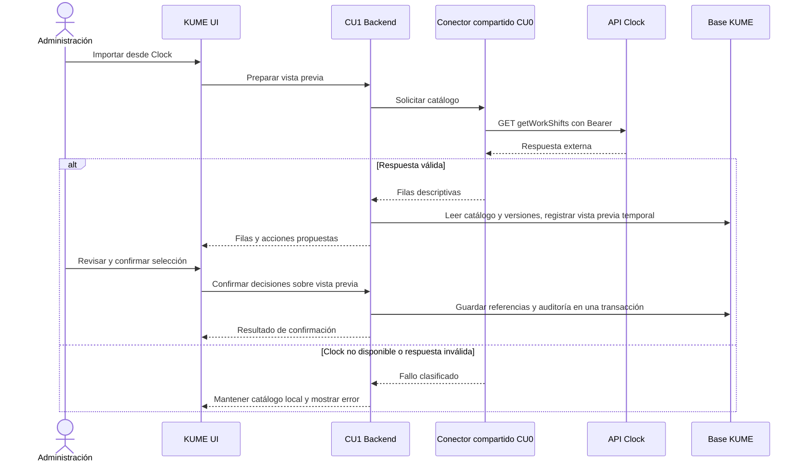
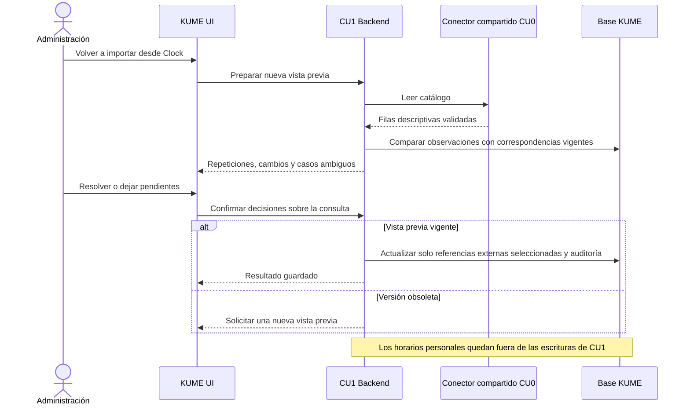

# CU1 — Sincronizar workshifts / horarios laborales

Fecha: 23/11/2026. Actor: administración. Entrada UX solicitada por Maxi: Administración → Horarios laborales → Importar desde Clock. Estado: caso identificado y solicitud de importación aprobada; diseño detallado de UI, correspondencia y uso como plantillas todavía propuesto. Sin implementación.

## Objetivo y límite

Importar a KUME el catálogo de turnos de Clock para alinear referencias/nombres y administrarlos localmente. Un workshift externo no equivale por sí solo al horario semanal efectivo de una maestra. Este caso no vincula empleados ni importa marcas y no escribe en Clock.

Endpoint documentado y respuesta aportada: GET `/api/EmployeesWorkShifts/getWorkShifts`, base `https://api.portalempleado.softwareclock.com/`, autenticación Bearer obtenida con usuario API. Swagger declara la operación sin parámetros y documenta la lista dentro de `work_shifts`. En la prueba de Maxi, el Bearer de su conexión devolvió el catálogo de su backoffice sin enviar nombre de empresa. Existe POST `assignMotherWorkShiftToEmployee` en la colección histórica, fuera de alcance por ser escritura.

## Lectura de la respuesta

La [evidencia de API](../../technical/softwareclock-api.md#catálogo-de-turnos-recibido--23112026) registra el catálogo observado. Las etiquetas que mencionan horas o descansos se muestran como texto del proveedor. «Libre» tampoco define una jornada prevista. Cada fila se conserva en la consulta, incluso cuando varias llegan sin código.

## Flujo propuesto

1. En Administración → Horarios laborales se muestra el catálogo local aunque Clock esté indisponible. «Importar desde Clock» consulta y abre una vista previa con código (o «Sin código»), nombre, tipo, correspondencia local, acción y motivo. Mostrar fecha de consulta, de última confirmación y recuentos por resultado.
2. Para cada referencia nueva o modificada, administración puede «Crear referencia», «Vincular a referencia existente» o «Dejar pendiente». Mostrar los valores actuales y propuestos antes de vincular o sustituir una correspondencia. Una coincidencia exacta y previamente confirmada puede presentarse como «Ya observada», sin cambio. Una fila con código duplicado lleva una alerta. Las filas totalmente indistinguibles se muestran con cantidad y quedan pendientes, pues elegir una por posición inventaría identidad.
3. Confirmar aplica únicamente las decisiones seleccionadas. Cancelar vuelve al catálogo. Ante error de consulta se mantiene la última información local. Si otra confirmación cambió el catálogo, se pide preparar una vista previa nueva y revisar de nuevo. El resultado separa altas, actualizaciones de metadatos externos, observaciones repetidas y pendientes.
4. Una referencia previa que no aparece en una consulta comparable se informa como «No observada en esta consulta», sin baja ni inferencia sobre la integridad de Clock. Una consulta vacía informa «Clock no devolvió filas» y conserva el catálogo. Un alcance distinto o desconocido impide interpretar ausencias.

### Controles de la vista previa propuestos

Al abrir la vista previa, las altas y vinculaciones quedan sin seleccionar. Las filas «Ya observada» y «No observada en esta consulta» son informativas. Para confirmar, debe haber al menos una decisión aplicable. En una vinculación, el control de destino muestra la etiqueta local y la descripción externa vigente, si existe. Al guardar, se muestran los recuentos de altas, actualizaciones, repeticiones y pendientes, y un acceso para volver al catálogo. Si la vista quedó obsoleta, se vuelve a consultar y se revisan las decisiones sobre los datos actuales.

### Primera importación

### Reimportación

## Decisiones pendientes

Maxi propuso guardar un inicio y un fin opcionales en cada referencia de KUME. Se completan localmente y se conservan al reimportar. Si el turno de una maestra tiene una correspondencia inequívoca, esas horas podrán proponerse como bloque inicial en una ficha todavía sin horario. La precarga se confirma y se copia al horario propio. El par de horas necesita días y vigencia confirmados para definir un horario laboral calculable. Quedan por revisar el editor, las pausas, los turnos nocturnos y la convivencia con la precarga aprobada desde cursos. Ninguna importación puede alterar horarios personales ya definidos ni provocar recálculos de historia.

[Especificación y aceptación](../../specs/012-softwareclock-workshifts/spec.md) · [Propuesta técnica](../../specs/012-softwareclock-workshifts/technical-spec.md) · [Plan](../../specs/012-softwareclock-workshifts/plan.md) · [Tareas](../../specs/012-softwareclock-workshifts/tasks.md)
