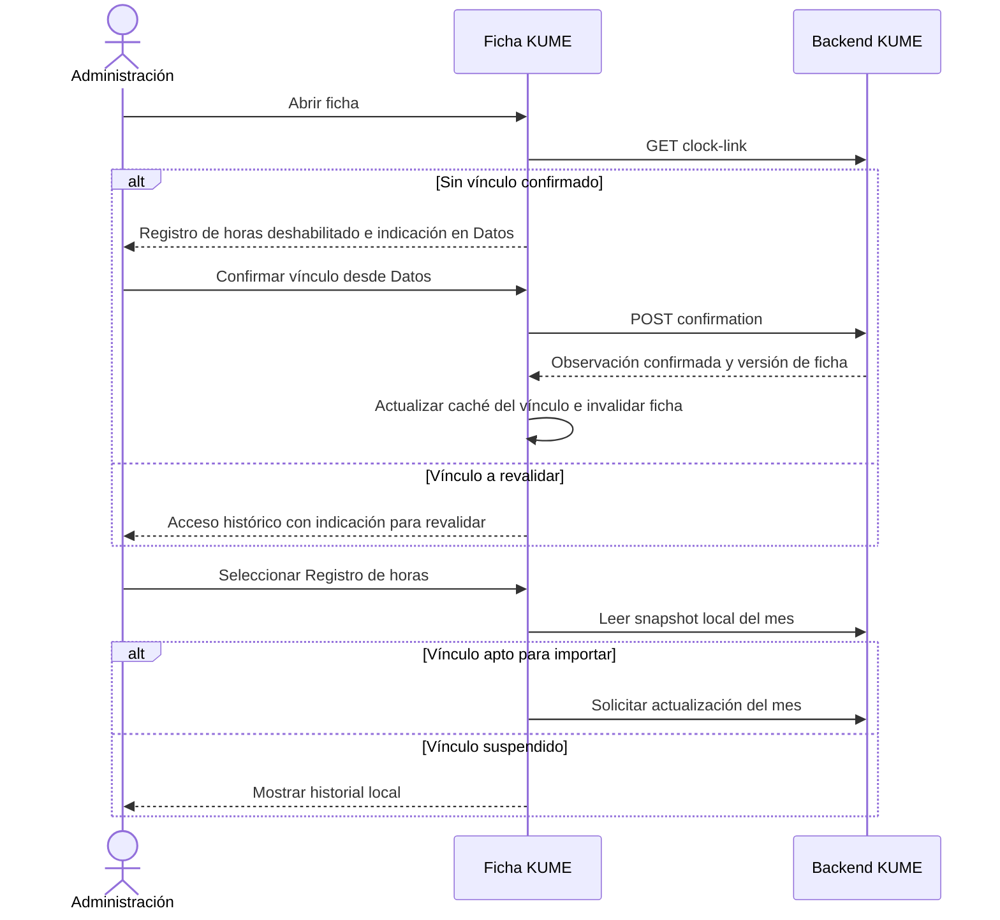

# Registro de horas — Diseño técnico propuesto

Fecha: 23 de noviembre de 2026. Diseño basado en [spec.md](spec.md) y Q1–Q31 aprobados. El 25/11 se autorizó ampliar el contrato local. El esquema de persistencia y el algoritmo de asignación quedan sujetos a revisión. La modificación local de OpenAPI requiere publicación de una revisión inmutable antes de fijar consumidores.

## Arquitectura y unidades

Conservar React/TypeScript/Vite, Fastify, PostgreSQL y Prisma. Backend: módulo `time-records` con dominio puro para horarios, intervalos e interpretación; aplicación para casos de uso; puertos de proveedor, almacenamiento, reloj y transacción; adaptadores Clock/Prisma; HTTP con TypeBox. Composición inyecta todo. Dominio y aplicación no importan HTTP, ORM ni variables de entorno.

Personal aporta rol y estado/egreso por un contrato de aplicación; CU2 aporta la identidad vinculada y el documento externo exacto; no consultar sus tablas desde HTTP ni crear ciclos. La lectura mensual usa el horario propio vigente. La propuesta inicial en CU2 proviene del workshift y su definición estructurada. Módulo propio en frontend `features/time-records`, integrado en la ficha mediante composición y componentes compartidos.

## Representación temporal y cálculo

- Fechas de negocio civiles y mes en America/Montevideo; usar `issued` directamente como hora civil, según decisión del 26/11. No aplicar conversiones de zona ni usar `created` para el cálculo.
- Persistir el timestamp original y su interpretación validada. Derivar minuto local por truncamiento de segundos de cada evento; no modificar el original. Horas manuales en HH:mm y fechas YYYY-MM-DD.
- Bloques e intervalos como rangos semiabiertos `[startMinute, endMinute)`. Validar inicio menor que fin y bloques sin superposición. Si dos originales distintos se truncan al mismo minuto, conservar ambos; no deduplicar por hora ni formar intervalos de duración cero como trabajo confirmado.
- Normalizar uniones de intervalos antes de comparar. Sea P la unión de bloques previstos aplicables, A la unión de intervalos reales confirmados: trabajo = longitud(A), adicional = longitud(A menos P), faltante = longitud(P menos A), saldo = adicional − faltante. A no se recorta a P.
- No registrar faltantes futuros: aplicar fecha/hora del reloj de negocio y margen vigente antes de declarar una posición vencida. Los días futuros no integran diferencias ni conteo de incidencias; la respuesta debe distinguir pendientes futuros, en curso y días que requieren revisión.
- Aplicar la fórmula completa solo a días resueltos. Si faltan extremos o hay ambigüedad, el día conserva trabajo confirmado parcial y saldo nulo con causa; no computar P menos A como faltante conocido. El mes acumula trabajo confirmado y previstos; diferencias solo de días resueltos, con `isPartial` y conteo de pendientes.
- Licencia/enfermedad sin trabajo confirmado: guardar la referencia original para auditoría y una excepción justificada sin obligación laboral efectiva; P efectivo vacío y cero faltante, identificar justificación. Otro confirmado: A vacío y P conservado. Una marca incompatible con una confirmación de no trabajo requiere revisión, no coexistencia silenciosa de estados contradictorios.
- Trabajo sin pausa confirmado: A puede cubrir la pausa, sin mutar P. Días sin jornada o posteriores al egreso no se convierten en adicionales automáticamente; aplicar AC18/AC21.

Límites de la primera implementación propuestos: bloques dentro de una fecha civil; no asumir soporte nocturno ni reglas de redondeo nuevas. Configuración que requiere cruce de día debe detectarse y resolverse explícitamente antes de habilitarla.

## Vigencias y edición retroactiva

Cada revisión global conserva margen y tolerancia. La tolerancia se resuelve por fecha junto al margen y se compara en minutos por posición de entrada confirmada, incluidas las decisiones válidas. El indicador no cambia las horas ni los saldos.

Horario laboral por maestra: revisiones semanales con `effectiveFrom`; resolver la última vigente para cada fecha, más excepción específica. No editar una revisión usada destruyendo su historia. Margen general de KUME igualmente versionado por vigencia; valor inicial 60. Validar entero no negativo; el límite superior se define con contrato, sin copiar 180 de la maqueta.

La [carga inicial de CU2](../../functional/softwareclock/sincronizar-empleado.md) propone la definición estructurada del workshift y permite editar y guardar una copia con vigencia explícita. Validar los bloques editados antes de guardar.

Cambio que afecte fechas anteriores: crear propuesta y vista previa con fechas/personas, interpretaciones y ajustes afectados, versiones de horario/margen/diarios y de la ficha. Confirmación vuelve a validar esas versiones dentro de transacción; si cambió algún recurso, 409 y nueva vista previa. Aplicar propuesta y recálculos atómicamente, conservando auditoría; ajustes incompatibles quedan pendientes. Una vista previa de margen global incluye todas las maestras afectadas, no solo la ficha abierta.

## Interpretación y revisión

Generar candidatos para cada posición esperada según margen vigente, fecha y orden. Cada evento puede ocupar una sola posición. Respetar asignaciones administrativas explícitas y eventos posteriores al egreso excluidos. No puntuar por cercanía para romper empates.

Formalización propuesta: considerar emparejamientos parciales ordenados de máxima cardinalidad entre candidatos elegibles; una posición solo se asigna automáticamente si tiene el mismo evento en todos esos emparejamientos. Posiciones sin evento común permanecen pendientes. La formalización se aisló en dominio y se prueba con ejemplos AC07. Sigue pendiente su revisión antes de cablearla a la importación. No resolver por orden de llegada ni por identificador.

La revisión admite referencias a originales existentes, horas manuales solo en posiciones sin marca, confirmación de intervalos continuos sin pausa y clasificación de no trabajo. Motivo/causa opcional, incluido vacío. Validar en backend originales pertenecientes a maestra/día, orden, no reutilización y coherencia de confirmaciones. No incluir campos editables `issued` o `created` en comandos administrativos.

Al llegar original para un faltante completado manualmente: evaluar con contexto vigente y los demás eventos. Si es único y no contradice decisiones explícitas, usarlo en lugar de la hora manual, sin borrar el registro anterior; auditar actor sistema/origen importación y cambio. Ambigüedad conserva hora manual e incidencia. Una decisión de asignación de un original nunca permite editarlo mediante hora manual sustitutiva.

## Persistencia propuesta

| Unidad lógica | Contenido mínimo e invariantes |
| --- | --- |
| `labor_schedule_revision` | Ficha, vigencia, versión; bloques semanales y actor/instante; sin vigencias duplicadas para misma ficha |
| `labor_schedule_exception` | Ficha/fecha, jornada especial o justificación, causa opcional, versión y relación con revisión anterior |
| `interpretation_policy_revision` | Vigencia global, margen entero, versión, auditoría |
| `clock_attendance_event` | Conexión/empresa, identidad externa verificada, documento como texto, issued original y normalizado, created si viene, primera/última observación |
| `clock_attendance_revision` | Evidencia de cambios recibidos del proveedor, sin actualización destructiva del original ni edición administrativa |
| `attendance_day` | Ficha/fecha únicos, versión de revisión, horario/margen aplicados, estado y selecciones; intervalos confirmados y confirmación de no trabajo |
| `attendance_audit` | Entidad/fecha, actor autenticado o sistema, momento, operación, antes/después y causa opcional; append-only |
| `attendance_import` | Ficha/mes, inicio/fin, éxito/error sanitizado, revisión importada y última consulta exitosa |

FK restrictivas y checks de fechas/minutos/versiones positivas; vínculos originales→asignaciones no se borran en cascada. No introducir tabla de usuarios: actor de la sesión existente se captura como identidad de auditoría. Resultados derivados pueden almacenarse como snapshot con revisiones aplicadas, nunca como una segunda autoridad independiente del núcleo.

La clave de reimportación acordada el 26/11 es `(connection, document, issued)` con el documento exacto y el texto original de `issued`. KUME conserva una marca por clave. Si Clock devuelve varias filas con la misma clave, se toma la primera válida en el orden de la respuesta aunque la metadata difiera. En una reimportación se conserva la fila ya guardada. `code` se conserva como metadata de origen. Si Clock cambia/elimina un evento, conservar versiones y marcar revisión; la ausencia de una marca en una respuesta no demuestra borrado. No implementar borrado por omisión sin contrato del proveedor validado.

Migración aditiva revisada antes de ejecución; no cambiar tablas de cursos para mantener herencia viva. Adaptar el flujo de egreso/cambio de documento con el módulo de horas: el control de versión de la ficha y recalculación deben evitar que una sesión antigua revierta el corte inclusivo. No bloquear toda la ficha en cada refresco si no cambian sus datos.

## Concurrencia y atomicidad propuestas

- Diario con versión propia; horario de la maestra con versión de configuración; margen global con versión propia. Formularios capturan versiones al abrir; una consulta en segundo plano no renueva silenciosamente el borrador.
- Revisión de día verifica también revisiones de horario/margen y versión relevante de ficha/egreso. 409 conserva trabajo; jamás reintentar con una versión nueva automáticamente.
- Importación hace red fuera de transacción. Al aplicar, validar la revisión de vínculo capturada y releer decisiones administrativas, egreso y política actuales bajo bloqueo/versión del diario. Si una consulta iniciada después ya se aplicó para la misma ficha y mes, la consulta anterior no reemplaza el snapshot ni cambia su frescura. Un fallo actual modifica el estado de actualización sin borrar el último éxito.
- Orden estable de bloqueos: política/configuración implicada, fichas ordenadas por UUID y diarios por ficha/fecha. Diseñar coordinación real con operaciones de Personal antes de ejecutar SQL; comprobar con PostgreSQL, no solo mocks.
- Un import repetido sin novedades no altera revisiones administrativas; sí puede actualizar última consulta exitosa. Cada transición material y comando administrativo aceptado compara/incrementa su versión y produce auditoría en la misma transacción.
- Lectura mensual consistente con una revisión de snapshot; no sumar filas de generaciones distintas durante un refresco. Cambiar de mes cancela/ignora respuesta anterior.

## Conector Clock y actualización

Hechos comprobados manualmente por Maxi en [softwareclock-api.md](../../technical/softwareclock-api.md): Basic GET `/api/ClockApiUser` sobre Portal del Empleado devuelve token; Bearer GET `/api/Attendance/getAttendances` devuelve asistencias por fechas. No se dispone de credenciales en este trabajo y no se ejecutó consulta real.

Backend toma URL/usuario/contraseña de secrets de despliegue. URL fija autorizada, no elegible desde el navegador. Cliente con timeout, límite de tamaño, validación de esquema y error sanitizado; no seguir redirecciones que expongan Authorization. Token en memoria backend, no base ni logs. Renovación coordinada para evitar varias autenticaciones simultáneas; no asumir duración. Ante fallo de autenticación invalidar token, intentar obtener uno nuevo y repetir solo lectura de forma acotada según contrato verificado; no bucles ni reenvío de escrituras.

Consulta mensual por documento, tras validar filtro y límites. Adaptador recibe rango civil y devuelve eventos tipados más evidencia de cobertura. Validar HTTP y envelope `message`/`attendances`: HTTP 200 no acredita estructura válida. Un resultado parcial, truncado o inválido no reemplaza la última consulta completa; registrar fallo y conservar snapshot. No cargar en memoria indefinidamente una respuesta de tamaño desconocido.

GET interno lee lo persistido sin hacer mutaciones ocultas; frontend dispara comando explícito de actualización al abrir/cambiar mes o con Actualizar. Ese comando puede dispararse automáticamente por la UI, pero no se reintenta ciegamente. Compartir consulta en curso por ficha/mes para evitar duplicados. No hay tarea programada ni POST al proveedor. Sin internet en intranet conserva lectura local y error de actualización visible.

## Contrato HTTP incorporado al OpenAPI local

Prefijo `/api/v1`. Todas las rutas exigen sesión; comandos además Origin y `X-Kume-Request` vigentes.

| Método | Ruta | Intención |
| --- | --- | --- |
| GET | `/staff-members/{staffMemberId}/time-records?month=YYYY-MM` | Snapshot mensual, versiones, horarios, originales visibles HH:mm, estados, totales, parcialidad y última consulta |
| POST | `/staff-members/{staffMemberId}/time-record-imports` | Actualizar mes `{month}` desde Clock; responder nuevo snapshot o error conservando último |
| PUT | `/staff-members/{staffMemberId}/time-records/{date}` | Revisión con versión del día/contexto; selecciones de eventos, faltantes manuales, intervalos sin pausa o no trabajo; causa opcional |
| GET | `/staff-members/{staffMemberId}/time-records/{date}/history` | Auditoría autorizada; instantes de auditoría y marcas se presentan sin segundos |
| GET | `/staff-members/{staffMemberId}/labor-schedules` | Vigencias y excepciones propias |
| POST | `/staff-members/{staffMemberId}/labor-schedule-previews` | Validar borrador, devolver afectados y token de confirmación ligado al contenido/versiones |
| POST | `/staff-members/{staffMemberId}/labor-schedule-changes` | Confirmar carga, vigencia o excepción conforme vista previa válida |
| GET | `/time-record-policies` | Vigencias de margen y tolerancia |
| POST | `/time-record-policy-previews` | Preparar una vigencia global y revisar días afectados |
| POST | `/time-record-policy-previews` | Vista previa de cambio/reproceso global |
| POST | `/time-record-policy-changes` | Confirmar vigencia/reproceso, con revisión de afectados |

La sugerencia inicial puede acompañar la lectura de configuración mientras no exista horario, nunca un GET que guarde automáticamente. Snapshot distingue horario desconocido de día conocido sin jornada. El resumen mensual agrupa las diferencias en `differences` y contiene `confirmedMinutes`, `plannedMinutes`, `pendingDayCount` e `isPartial`; diferencias de día incompleto son null, no cero. Egreso/no referencia/justificación se identifican por razón, sin ambigüedad de estados.

Errores propuestos: 409 `VERSION_CONFLICT` / `PREVIEW_STALE`, 422 para revisión/horario inválido, 502 para respuesta externa inválida y 503 para indisponibilidad/no configuración. El 401 corresponde a la sesión de KUME. El contrato local define códigos HTTP y esquemas. Las claves de problema específicas y la traducción de fallos externos deberán verificarse al implementar los manejadores.

## Frontend y pruebas

React Hook Form/Zod para revisión, horarios/excepciones y margen; TanStack Query para snapshots y actualización, claves por ficha/mes, limpieza al salir de sesión. Reutilizar cliente y diálogos existentes; no duplicar componente de ficha. Ningún fetch directo a Clock. Mantener borrador y retorno al control de origen, cancelar/confirmar descarte; no ocultar solo por color una incidencia o un saldo parcial.

Núcleo: ejemplos numéricos AC13–AC19, truncamiento, union/intersección, vigencias, igualdad de candidatos y límite exacto de margen; propiedad `saldo = adicional − faltante`, sin doble conteo. Pruebas de casos de uso con puertos tipados y reloj controlado. HTTP con servidor de prueba del proveedor, errores/envelope inválido, timeout y token vencido; ninguna necesita datos reales en fixtures. PostgreSQL real para unicidad, migraciones, auditoría y carrera importación/edición/reproceso/egreso. Frontend con Testing Library para controles, conflictos, originales no editables, motivo vacío, parcialidad y estados de servicio.

No declarar probado un comportamiento de Clock mediante un servidor simulado; la matriz de validación de proveedor en tareas requiere evidencia separada. Operación: respaldar nuevas tablas junto con base; deshabilitar nuevas rutas/entrada de UI si hay fallo de despliegue, conservando datos. No revertir mediante DROP de historial/importaciones; restauración o migración correctiva revisada por separado.

## Prioridad de investigación de endpoints y vínculo persistente

Por indicación de Maxi, cerrar primero el [mapeo KUME–Clock y sus secuencias](../../technical/softwareclock-employee-mapping.md). El vínculo persistido evita volver a descubrir empleados al consultar el mes. `document` es el filtro documentado de asistencias; `id`/`code` del empleado no habilitan por sí mismos un filtro alternativo. El workshift es la fuente de la propuesta inicial de CU2 cuando existe una definición local inequívoca. El horario ya confirmado se mantiene independiente. El contrato de CU2 permanece compatible con el primer hito de vínculo sin horario.

## Ampliación posterior: catálogo administrativo Clock

La muestra de getWorkShifts contiene solo code/name/type y códigos vacíos repetidos. Maxi solicita importación administrativa de horarios y botón de sincronización de empleado. [Diseño extendido y diagrama](../../technical/softwareclock-employee-mapping.md). Antes de crear tablas/rutas, revisar identidad local, correspondencias ambiguas, reimportación y estados de configuración. La respuesta actual no habilita generar bloques desde nombres ni actualizar horarios de maestras por herencia viva. Posible uso como plantillas queda como propuesta explícita pendiente.

## Entrada a la ficha y transición de CU2

La navegación usa el estado y la observación publicados por CU2. Un fallo
transitorio de lectura del vínculo no equivale a un vínculo inexistente.
El permiso de consultar el historial se evalúa independientemente de la
aptitud para importar. La API comprueba el rol, la ficha y la aptitud
del vínculo al comenzar una importación y vuelve a verificar su revisión,
la revisión de cédula y el contexto de egreso antes de aplicar la respuesta.
Si la identidad dejó de ser apta durante la consulta, se descarta el resultado
y se mantiene el último snapshot. El horario desconocido afecta el cálculo
y no la lectura. El supuesto de estabilidad del ID de empleado de CU2 no
resuelve V03, que corresponde a los eventos de asistencia.
