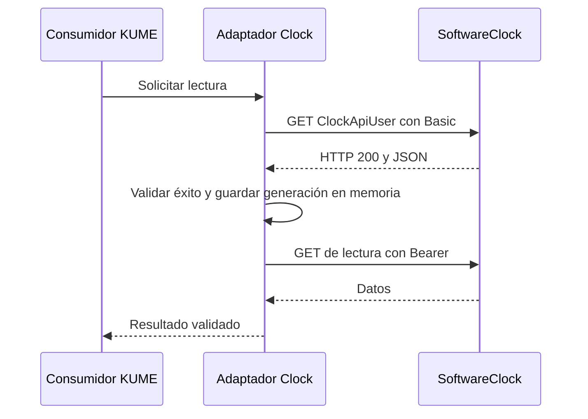
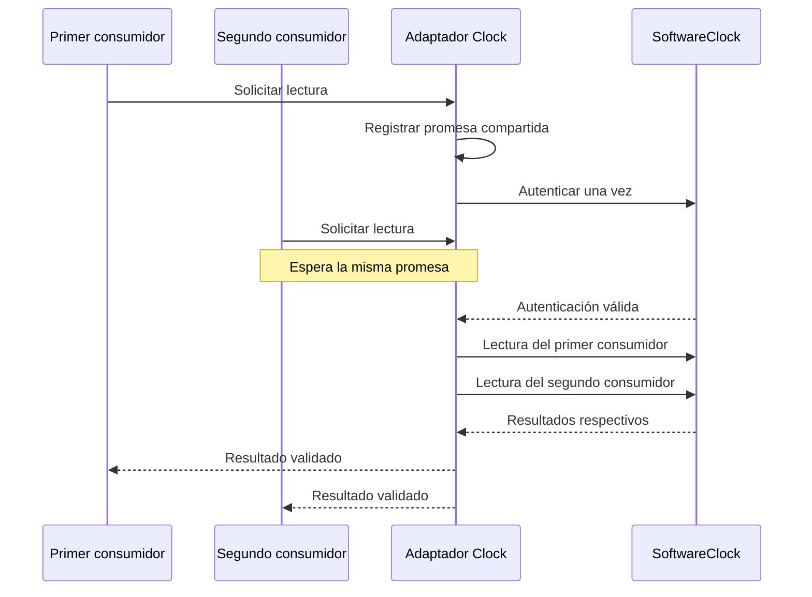
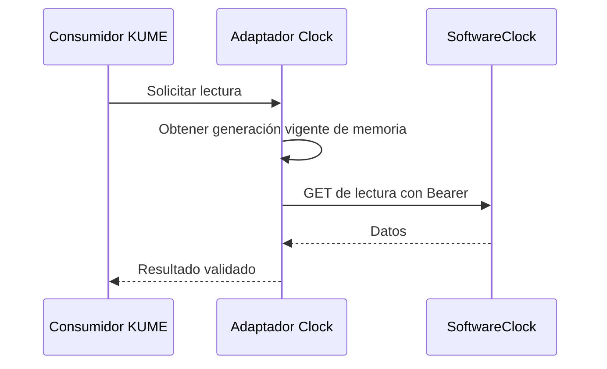
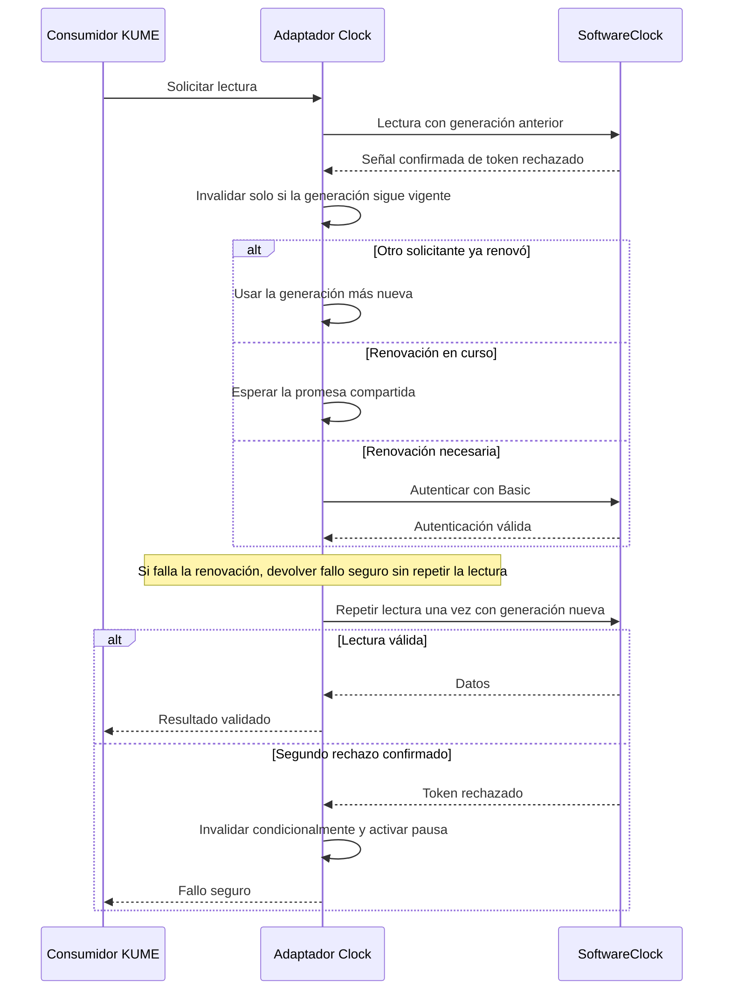
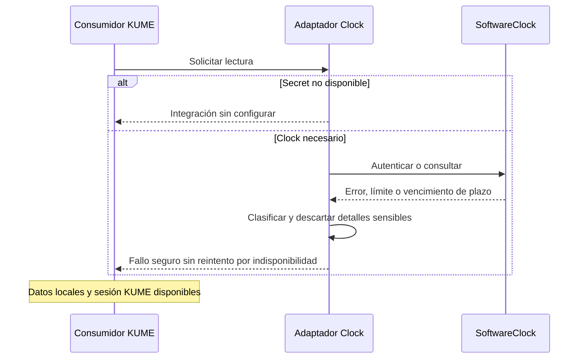

# CU0 — Especificación técnica propuesta

## Composición y protocolo

Fastify y TypeScript strict. En el backend revisado (main, `2a1d7ab`), `src/composition/config.ts` carga rutas de configuración y Compose monta el archivo de sesión en solo lectura. Se propone reutilizar ese patrón para un archivo separado de Clock. Composición lee y valida una vez antes de atender tráfico, prepara el adaptador y entrega a cada puerto de aplicación la misma instancia de infraestructura. Dominio y aplicación reciben resultados tipados de lecturas y categorías de fallo, sin tipos HTTP externos ni credenciales. El adaptador mantiene el par Basic y el token como estado privado. Ningún cambio en OpenAPI, sesión ni esquema de datos.

- HTTPS contra el origen comprobado, con validación TLS, rutas de lectura controladas por el adaptador y redirecciones deshabilitadas. Basic se adjunta exclusivamente a GET `/api/ClockApiUser`. Bearer se adjunta a las lecturas autorizadas del mismo origen. Usar el transporte disponible en Node sin incorporar dependencias de producción.
- La autenticación exige HTTP 200, JSON objeto validado desde `unknown`, `code` con tipo y valor de éxito confirmados, `message` del tipo esperado y token no vacío que pueda representarse como credencial Bearer sin espacios ni controles. Acotar tamaño de respuesta, descartar el texto de `message` y cerrar ante esquema o código desconocidos. Un token presente no rescata un código de error.
- Tratar el token como opaco. Hasta contar con evidencia de expiración contractual, renovar de forma reactiva ante una señal demostrada. Usar una lista explícita de señales por respuesta de lectura, con estado y código si corresponde. Un rechazo genérico no habilita renovación. Sin endpoint de refresh confirmado, una renovación usa la autenticación Basic original. Si aparece un JWT, sus claims no se usan como contrato ni se recopilan para diagnóstico.

## Coordinación y límites

Guardar una referencia de generación junto al token, incluso si Clock entrega el mismo valor en dos autenticaciones. Registrar la promesa de autenticación antes de ceder el control y compartirla con todos los solicitantes. Publicar la nueva generación solo tras validación completa. Liberar la promesa al terminar, tanto en éxito como en fallo. La cancelación individual deja de esperar sin abortar el trabajo común. En el despliegue de un proceso, la coordinación es por proceso. Antes de multiplicar procesos, verificar cuotas y si una emisión invalida tokens anteriores.

Una lectura guarda la generación usada. Ante rechazo confirmado, invalida solo si sigue vigente. Si otro solicitante ya inició la renovación, espera esa promesa. Si ya publicó una generación más nueva, usa esa generación. El presupuesto es de una sola repetición por lectura. Un segundo rechazo confirmado invalida condicionalmente la generación usada, termina con fallo y activa una pausa compartida para evitar un ciclo entre solicitudes nuevas. Reiniciar descarta token, promesa y pausas.

| Escenario | Tratamiento propuesto |
| --- | --- |
| Arranque o reinicio | Validación local del secret. Autenticación bajo demanda, sin llamada a Clock en arranque ni dependencia en el health check básico. |
| Configuración ausente, ilegible o inválida | Propuesta a confirmar. Mantener KUME disponible, marcar Clock no configurado y omitir llamadas externas. |
| Credenciales explícitamente rechazadas al autenticar | Marcar fallo de credenciales solo con señal confirmada. Suspender nuevos intentos hasta recarga por reinicio con configuración revisada. |
| Timeout o 5xx, fallo de red y protocolo inesperado | Fallo seguro, sin reintento automático por ese motivo. Si ocurre en autenticación, aplicar una pausa compartida antes de permitir un intento a demanda. Conservar un token existente ante un fallo de lectura sin rechazo confirmado. |
| 429 en autenticación o lectura | Pausar nuevas llamadas a Clock por proceso. Respetar `Retry-After` válido como fecha o segundos. Sin valor fiable, usar la pausa operativa documentada. No repetir la lectura automáticamente. |
| Permiso denegado o señal desconocida | Fallo de integración sin reautenticar ni interpretar como sesión KUME vencida. |

Antes de implementar, fijar límites positivos de duración y tamaño del cuerpo, presupuesto total de cada operación (incluida la espera compartida y eventual repetición) y pausa operativa para fallos. Usar límites locales y pruebas controladas, con valores revisados según las guías de despliegue y evidencia del proveedor. Un plazo vencido cancela transporte y lectura de cuerpo o finaliza la espera individual según quién sea dueño del plazo.

## Frontera de error y observabilidad

Capturar fallos de lectura del secret, transporte, cancelación, parseo y validación dentro de la integración o composición según corresponda. Convertirlos a valores internos con categoría, etapa y metadatos permitidos como duración y estado HTTP numérico. No propagar errores crudos ni su cadena de causas, incluso en excepciones de arranque. Excluir cabeceras, cuerpos, URLs con filtros, mensajes del proveedor y objetos del cliente de serializers, trazas automáticas y métricas. Los consumidores traducen el fallo con sus contratos vigentes, conservan el estado local y evitan abrir transacciones durante solicitudes de red. Un rechazo externo jamás se convierte en un 401 de sesión KUME ni envía una cookie de cierre.

## Secuencias

### Primera solicitud sin token

### Solicitudes concurrentes

### Reutilización de token

### Rechazo del token y renovación acotada

### Fallo de autenticación o indisponibilidad

