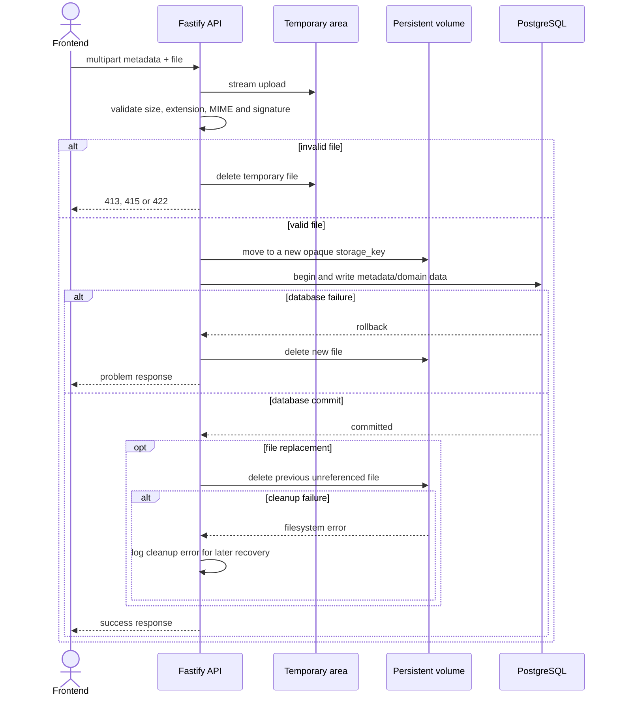

# KUME — Diseño de API

Este documento resume las decisiones del contrato HTTP. Las operaciones funcionales se conservan en [OpenAPI](../../openapi.yaml). Actualización del 2 de noviembre de 2026: Fastify se ejecutará inicialmente en Oracle Cloud Always Free, con Docker Compose y alternativa de migración completa a intranet. El contrato incluye login, consulta de sesión, logout y seguridad por cookie; diseño detallado en [autenticación](autenticacion-prototipo.md). Diseño técnico completo con scrypt y umbrales de intentos confirmados; implementación y verificación pendientes.

## Convenciones

- REST sobre HTTP bajo `/api/v1`; salud y documentación quedan fuera de la versión.
- Rutas plurales en `kebab-case`, propiedades JSON en `camelCase` y UUID en identificadores.
- Fechas civiles en `YYYY-MM-DD`; instantes en ISO 8601 UTC.
- Importes decimales como texto, por ejemplo `"1250.50"`.
- JSON para datos y `multipart/form-data` exclusivamente para cargas de archivos.
- Días: `monday` a `sunday`. Turnos: `morning` y `afternoon`.
- Roles: `teacher`, `assistant` y `workshopInstructor`.
- Operaciones de negocio y archivos accesibles solo por cuentas habilitadas de secretaria y Maxi. Maxi y Vicky tienen los mismos permisos; credenciales individuales en secrets, sin tabla de usuarios ni recuperación por correo. Cierre manual y expiración tras 8 horas de inactividad, con limitación temporal de intentos por cuenta y por IP. Ver [alcance y tareas de autenticación](autenticacion-prototipo.md).
- Login: 5 fallos por cuenta o 20 por IP en ventana móvil de 15 minutos activan una pausa de 15 minutos, con `429` y `Retry-After`; la petición bloqueada no prolonga la pausa. Cambiar contraseña requiere actualizar secrets y reiniciar, cerrando todas las sesiones.
- Sesiones opacas en memoria de un único proceso Fastify; cookie `__Host-kume_session` Secure, HttpOnly, SameSite=Strict y Path=/, sin Domain. Reiniciar exige nuevo login. Escrituras, login y logout exigen Origin configurado y `X-Kume-Request: 1`; errores 401/403/429 definidos en OpenAPI. GET de sesión no renueva actividad.
- HTTPS en el acceso cloud y en el destino local según su configuración. CORS acepta únicamente el origen configurado del frontend y no sustituye autorización.

El frontend traduce valores técnicos mediante mapas de presentación, por ejemplo `morning` → “Matutino”, `afternoon` → “Vespertino” y `monday` → “Lunes”.

## Recursos y rutas

### Sistema

| Método | Ruta | Resultado |
|---|---|---|
| `GET` | `/health` | Estado de la API y de PostgreSQL para Docker Compose |
| `GET` | `/openapi.json` | Contrato OpenAPI servido por la aplicación |
| `GET` | `/documentation` | Interfaz Swagger según entorno y política de acceso |

### Autenticación

| Método | Ruta | Resultado |
|---|---|---|
| POST | `/api/v1/auth/login` | `username` y `password`; crea cookie y devuelve usuario y `expiresAt` |
| GET | `/api/v1/auth/session` | Consulta sesión sin renovar actividad |
| POST | `/api/v1/auth/logout` | Invalida sesión y limpia cookie; 204 idempotente |

Un mismo origen HTTPS sirve frontend y API. Las rutas funcionales y Swagger requieren sesión; login y logout no exigen una sesión previa, pero sí protección de origen y cabecera. Salud es una excepción exclusivamente interna. Ver [diseño detallado](autenticacion-prototipo.md).

### Rubros

| Método | Ruta | Resultado |
|---|---|---|
| `GET` | `/api/v1/categories` | Listar por estado |
| `POST` | `/api/v1/categories` | Crear |
| `GET` | `/api/v1/categories/{categoryId}` | Consultar |
| `PATCH` | `/api/v1/categories/{categoryId}` | Editar |
| `POST` | `/api/v1/categories/{categoryId}/deactivation` | Desactivar |
| `DELETE` | `/api/v1/categories/{categoryId}/deactivation` | Reactivar |

### Gastos y comprobantes

| Método | Ruta | Resultado |
|---|---|---|
| `GET` | `/api/v1/expenses` | Listar, filtrar y totalizar |
| `POST` | `/api/v1/expenses` | Crear gasto y comprobante en una carga multipart |
| `GET` | `/api/v1/expenses/export.csv` | Exportar el conjunto filtrado sin paginación |
| `GET` | `/api/v1/expenses/{expenseId}` | Consultar detalle y metadatos del comprobante |
| `PATCH` | `/api/v1/expenses/{expenseId}` | Editar un gasto activo |
| `POST` | `/api/v1/expenses/{expenseId}/cancellation` | Anular |
| `DELETE` | `/api/v1/expenses/{expenseId}/cancellation` | Restaurar |
| `PUT` | `/api/v1/expenses/{expenseId}/receipt` | Reemplazar comprobante |
| `GET` | `/api/v1/expenses/{expenseId}/receipt/content` | Descargar comprobante |

Filtros de gastos: `paymentDateFrom`, `paymentDateTo`, `categoryId`, `status`, `page` y `pageSize`. `status` admite `active`, `cancelled` o `all` y usa `active` por defecto. El total excluye anulados y se calcula sobre todo el conjunto filtrado, no sobre la página.

El CSV usa los mismos filtros sin paginación. Sus columnas son `Fecha de pago`, `Destinatario`, `Concepto`, `Rubro`, `Importe`, `Moneda` y `Estado`; se genera en UTF-8 con BOM, coma, escape RFC 4180 y CRLF.

### Personal y documentos

| Método | Ruta | Resultado |
|---|---|---|
| `GET` | `/api/v1/staff-members` | Buscar por nombre, apellido o cédula y filtrar por estado |
| `POST` | `/api/v1/staff-members` | Crear ficha |
| `GET` | `/api/v1/staff-members/{staffMemberId}` | Consultar con asignaciones y resumen documental |
| `PATCH` | `/api/v1/staff-members/{staffMemberId}` | Editar ficha activa |
| `POST` | `/api/v1/staff-members/{staffMemberId}/deactivation` | Inactivar con fecha de egreso y retirar asignaciones |
| `DELETE` | `/api/v1/staff-members/{staffMemberId}/deactivation` | Reactivar y limpiar fecha de egreso |
| `GET` | `/api/v1/staff-members/{staffMemberId}/documents` | Listar documentos |
| `POST` | `/api/v1/staff-members/{staffMemberId}/documents` | Subir nombre libre y archivo |
| `GET` | `/api/v1/staff-members/{staffMemberId}/documents/{documentId}/content` | Descargar |
| `DELETE` | `/api/v1/staff-members/{staffMemberId}/documents/{documentId}` | Eliminar registro y archivo |

Una ficha inactiva es de solo lectura: se puede consultar y descargar sus archivos, pero no editar, asignar, subir ni eliminar documentos. Reactivarla no restaura las asignaciones anteriores.

### Asignaciones

| Método | Ruta | Resultado |
|---|---|---|
| `GET` | `/api/v1/assignments` | Listar por persona, tipo, destino o turno |
| `POST` | `/api/v1/assignments` | Crear |
| `GET` | `/api/v1/assignments/{assignmentId}` | Consultar |
| `PUT` | `/api/v1/assignments/{assignmentId}` | Reemplazar destino o turno atómicamente |
| `DELETE` | `/api/v1/assignments/{assignmentId}` | Retirar sin historial |

Cada asignación contiene `staffMemberId`, `targetType`, `targetId` y `shift`. `targetType` admite `course` o `workshop`. El rol es informativo y no limita el tipo de destino.

### Cursos y talleres

Ambos recursos permiten listar, crear, consultar, editar, desactivar y reactivar mediante:

- `/api/v1/courses`
- `/api/v1/workshops`
- `/{resource}/{id}`
- `/{resource}/{id}/deactivation`

Un curso expone `name`, `level`, `internalName`, `days` y `shifts`. Un taller expone `name`, `days` y `shifts`. No se puede desactivar un destino con asignaciones.

Ampliación aprobada por Maxi el 7 de noviembre de 2026, pendiente de implementación y verificación final: cursos y talleres exponen `version` entero positivo, inicialmente 1. PATCH exige la versión leída y al menos un campo editable; las acciones POST/DELETE de `deactivation` exigen cuerpo JSON `{"version":1}`. Se compara e incrementa atómicamente la versión en cada escritura aceptada, incluidas acciones cuyo estado ya coincide. Una versión obsoleta produce `409` con código `VERSION_CONFLICT`, sin sobrescritura ni reintento automático. PATCH devuelve el recurso y su nueva versión; las acciones conservan 204 y requieren nueva consulta si se necesita leer la versión resultante. Esta ampliación es incompatible con clientes que escriben sin versión y exige despliegue coordinado. Se limita a cursos y talleres.

Ver [especificación de cursos y talleres](../specs/002-courses-workshops/spec.md) y [diseño técnico](../specs/002-courses-workshops/technical-spec.md). El contrato canónico es `openapi.yaml`; antes de publicar deben fijarse su revisión y los consumidores regenerados.


## Paginación, orden y relaciones

Los listados usan `page` y `pageSize`; sus valores iniciales son 1 y 25, y el máximo de `pageSize` es 100. La forma común es:

```json
{
  "items": [],
  "page": 1,
  "pageSize": 25,
  "totalItems": 0,
  "totalPages": 0
}
```

Órdenes fijos:

- Gastos por `paymentDate` y `createdAt`, ambos descendentes.
- Personal por `lastName` y `firstName` ascendentes.
- Rubros, cursos y talleres por `name` ascendente.
- Documentos por `createdAt` descendente.

Las respuestas incluyen resúmenes de relaciones para evitar peticiones repetidas. Los gastos incluyen rubro y metadatos del comprobante; las asignaciones incluyen destino y persona; el detalle de personal incluye asignaciones y resúmenes documentales.

## Escrituras y estados HTTP

- `POST`: `201 Created`, `Location` y recurso creado.
- `PATCH` y `PUT`: `200 OK` y recurso actualizado.
- Acciones y eliminaciones sin cuerpo: `204 No Content`.
- Descargas y CSV: `200 OK`.
- En `PATCH`, un campo omitido no cambia; `null` limpia únicamente campos opcionales.
- El supuesto local monousuario deja de aplicar: secretaria y Maxi pueden trabajar simultáneamente. Revisar estrategia de edición concurrente antes de implementar; conservar transacciones y restricciones únicas de asignaciones.

Clasificación de errores:

| Estado | Uso |
|---:|---|
| `400` | Petición o JSON malformado |
| `401` | Credenciales incorrectas o sesión ausente, inválida o vencida |
| `403` | Origen o cabecera de protección rechazados |
| `429` | Pausa temporal de login, con Retry-After |
| `404` | Recurso inexistente |
| `409` | Unicidad, asignación ocupada o baja bloqueada |
| `413` | Archivo mayor a 10 MB |
| `415` | Tipo de archivo no admitido |
| `422` | Campos o reglas de negocio inválidos |
| `500` | Error inesperado sin detalles internos |

Los errores usan `application/problem+json` con `type`, `title`, `status`, `detail`, `code` y errores opcionales por campo.

## Validaciones principales

- Solo UYU; importe mayor que cero; fecha de pago no futura.
- Un gasto anulado es de solo lectura hasta restaurarlo.
- Cédula uruguaya normalizada, válida y única.
- `birthDate` anterior al día actual; `startDate` no futura; `endDate` no futura ni anterior a `startDate`.
- Personal activo y destino activo para crear o cambiar una asignación.
- Destino y turno disponibles; días y turnos sin duplicados.
- No se puede quitar de un curso o taller un turno que todavía tenga una asignación.
- `internalName` opcional y único cuando existe; la búsqueda de cursos contempla `name` e `internalName`.
- Exactamente un archivo PDF, JPG o PNG de hasta 10 MB por carga.

## Persistencia segura de archivos



El archivo anterior nunca se elimina antes del commit. Si la limpieza posterior falla, se conserva un archivo huérfano para recuperación posterior en vez de arriesgar el archivo vigente.

Al eliminar un documento del personal se confirma primero el borrado de la fila y luego se elimina el archivo. Si esa limpieza falla, se registra el archivo huérfano para recuperación posterior; nunca se elimina primero un archivo todavía referenciado.

## Respaldo y restauración

No se exponen por HTTP ni requieren pantallas. Las tareas administrativas generan copias diarias cifradas de PostgreSQL y archivos como una unidad consistente y versionada, fuera de Oracle, con retención de 30 días y alertas. Se conserva ejecución manual para mantenimiento. Restauración con validación previa y confirmación antes de reemplazar datos; prueba inicial y trimestral. Incluir recuperación de cuentas y configuración. Ver [alcance](../functional/alcance-prototipo.md) e [infraestructura y migración](../devops/infraestructura-y-migracion.md).

## Despliegue cloud y local

La API Fastify y las rutas funcionales no se reemplazan por servicios propietarios de Oracle. PostgreSQL permanece privado en la red Compose; los archivos persisten en un volumen del servidor. El frontend accede mediante HTTPS y autorización; no se exponen claves administrativas ni archivos directamente por una URL pública sin control. Al migrar, se actualizan direcciones, orígenes, certificados y configuración de sesiones, manteniendo reglas funcionales y acceso de cuentas. La demo mantiene aislamiento de datos, archivos y credenciales.

## Gastos y rubros: concurrencia aprobada el 8 de noviembre de 2026

Gastos y rubros exponen `version` entero positivo, inicialmente 1. PATCH exige versión y al menos un campo editable. POST/DELETE de anulación/restauración y desactivación/reactivación exigen JSON `{"version":1}`. El reemplazo de comprobante exige el campo multipart `version`, referido al gasto; devuelve los metadatos del archivo y requiere volver a consultar el gasto para obtener su nueva versión.

Cada escritura aceptada compara e incrementa la versión atómicamente, incluidas acciones cuyo estado ya coincide. Una versión obsoleta produce 409 con `VERSION_CONFLICT`, sin sobrescritura ni reintento automático con versión nueva. El reemplazo y la edición/anulación comparten la misma versión del gasto. La creación no admite versión elegida por el cliente. El rubro resumido de un gasto conserva su forma actual; la versión del rubro se obtiene consultando el recurso correspondiente.

El día de negocio se resuelve en America/Montevideo. Importes como texto decimal exacto en HTTP y centésimos enteros en el núcleo. La decisión no acredita implementación desplegada. Ver [especificación técnica](../specs/003-payment-records/technical-spec.md).
