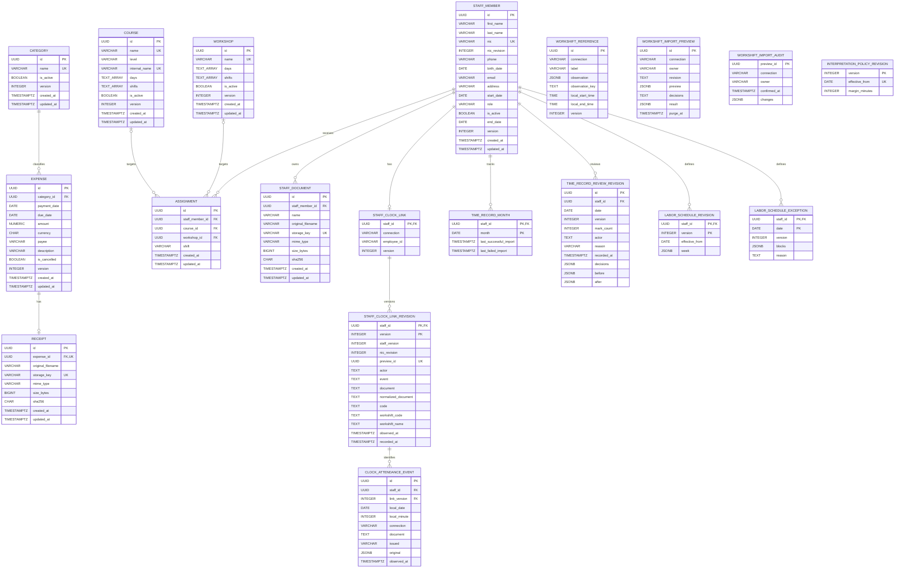

# KUME — Diseño de base de datos

Este documento define el modelo PostgreSQL del prototipo administrativo. Actualización del 2 de noviembre de 2026: se conserva el modelo funcional y Prisma, con ejecución inicial en Oracle Cloud Always Free y posible migración a intranet. Las credenciales de Maxi y Vicky se guardarán como hashes en secrets del servidor, sin tabla de usuarios; las sesiones se guardan en memoria de un único proceso backend, sin tabla de sesiones, y se pierden al reiniciar; las fichas del personal no son cuentas de acceso. Los nombres técnicos están en inglés, las tablas usan singular y las columnas usan `snake_case`. Los textos administrables y visibles para la usuaria permanecen en español.

## Diagrama entidad-relación

## Tablas

### `category`

| Columna | Tipo | Nulo | Valor inicial | Regla |
|---|---|---:|---|---|
| `id` | `UUID` | No | UUID generado | Clave primaria |
| `name` | `VARCHAR(100)` | No | — | Texto no vacío; único sin distinguir mayúsculas ni espacios exteriores |
| `is_active` | `BOOLEAN` | No | `true` | La baja es lógica |
| `created_at` | `TIMESTAMPTZ` | No | `CURRENT_TIMESTAMP` | — |
| `updated_at` | `TIMESTAMPTZ` | No | `CURRENT_TIMESTAMP` | Actualizado por trigger |

### `expense`

| Columna | Tipo | Nulo | Valor inicial | Regla |
|---|---|---:|---|---|
| `id` | `UUID` | No | UUID generado | Clave primaria |
| `category_id` | `UUID` | No | — | FK a `category.id`; `ON DELETE RESTRICT` |
| `payment_date` | `DATE` | No | — | Determina el período contable |
| `amount` | `NUMERIC(12,2)` | No | — | Mayor que cero |
| `currency` | `CHAR(3)` | No | `'UYU'` | Tres letras mayúsculas; la API acepta solo `UYU` en esta versión |
| `payee` | `VARCHAR(200)` | No | — | Texto no vacío |
| `description` | `VARCHAR(500)` | No | — | Texto no vacío |
| `is_cancelled` | `BOOLEAN` | No | `false` | Los anulados se conservan y no suman en totales |
| `created_at` | `TIMESTAMPTZ` | No | `CURRENT_TIMESTAMP` | — |
| `updated_at` | `TIMESTAMPTZ` | No | `CURRENT_TIMESTAMP` | Actualizado por trigger |

### `receipt`

| Columna | Tipo | Nulo | Valor inicial | Regla |
|---|---|---:|---|---|
| `id` | `UUID` | No | UUID generado | Clave primaria |
| `expense_id` | `UUID` | No | — | FK única a `expense.id`; `ON DELETE RESTRICT` |
| `original_filename` | `VARCHAR(255)` | No | — | Solo para mostrar o descargar |
| `storage_key` | `VARCHAR(255)` | No | — | Clave relativa, opaca y única |
| `mime_type` | `VARCHAR(50)` | No | — | PDF, JPEG o PNG |
| `size_bytes` | `BIGINT` | No | — | Entre 1 y 10.485.760 bytes |
| `sha256` | `CHAR(64)` | No | — | Hash hexadecimal; no es único |
| `created_at` | `TIMESTAMPTZ` | No | `CURRENT_TIMESTAMP` | — |
| `updated_at` | `TIMESTAMPTZ` | No | `CURRENT_TIMESTAMP` | Actualizado por trigger |

La base permite un gasto sin comprobante para no imponer la regla desde persistencia. La API permite crear el gasto sin archivo; devuelve receipt nulo mientras no se adjunte. Reemplazarlo actualiza la misma fila, sin historial de versiones.

### `staff_member`

| Columna | Tipo | Nulo | Valor inicial | Regla |
|---|---|---:|---|---|
| `id` | `UUID` | No | UUID generado | Clave primaria |
| `first_name` | `VARCHAR(100)` | No | — | Texto no vacío |
| `last_name` | `VARCHAR(100)` | No | — | Texto no vacío |
| `nic` | `VARCHAR(20)` | No | — | Cédula normalizada y única |
| `phone` | `VARCHAR(30)` | No | — | Texto no vacío |
| `birth_date` | `DATE` | Sí | — | — |
| `email` | `VARCHAR(254)` | Sí | — | — |
| `address` | `VARCHAR(500)` | Sí | — | — |
| `start_date` | `DATE` | Sí | — | — |
| `role` | `VARCHAR(30)` | No | — | `teacher`, `assistant` o `workshopInstructor` según la API |
| `is_active` | `BOOLEAN` | No | `true` | La baja es lógica |
| `end_date` | `DATE` | Sí | — | Obligatoria cuando `is_active` es `false` |
| `created_at` | `TIMESTAMPTZ` | No | `CURRENT_TIMESTAMP` | — |
| `updated_at` | `TIMESTAMPTZ` | No | `CURRENT_TIMESTAMP` | Actualizado por trigger |

### `course`

| Columna | Tipo | Nulo | Valor inicial | Regla |
|---|---|---:|---|---|
| `id` | `UUID` | No | UUID generado | Clave primaria |
| `name` | `VARCHAR(100)` | No | — | Nombre formal único y no vacío |
| `level` | `VARCHAR(100)` | No | — | Admite valores como `0`, `1` o `Escolares` |
| `internal_name` | `VARCHAR(100)` | Sí | — | Nombre animal; único si existe |
| `days` | `TEXT[]` | No | — | Uno o más días validados por la API |
| `shifts` | `TEXT[]` | No | — | Uno o más turnos validados por la API |
| `is_active` | `BOOLEAN` | No | `true` | La baja es lógica |
| `created_at` | `TIMESTAMPTZ` | No | `CURRENT_TIMESTAMP` | — |
| `updated_at` | `TIMESTAMPTZ` | No | `CURRENT_TIMESTAMP` | Actualizado por trigger |

Datos iniciales:

| `name` | `level` | `internal_name` |
|---|---|---|
| Maternal | `0` | `NULL` |
| Nivel 1 | `1` | Kiru |
| Nivel 2 | `2` | Cururu |
| Nivel 3 | `3` | Capibara |
| Nivel 4 | `4` | Ñurumi |
| Nivel 5 | `5` | Mamboreta |
| Escolares | `Escolares` | Pangui |

Todos comienzan con `days = ['monday', 'tuesday', 'wednesday', 'thursday', 'friday']` y `shifts = ['morning', 'afternoon']`.

### `workshop`

| Columna | Tipo | Nulo | Valor inicial | Regla |
|---|---|---:|---|---|
| `id` | `UUID` | No | UUID generado | Clave primaria |
| `name` | `VARCHAR(100)` | No | — | Único y no vacío |
| `days` | `TEXT[]` | No | — | Uno o más días validados por la API |
| `shifts` | `TEXT[]` | No | — | Uno o más turnos validados por la API |
| `is_active` | `BOOLEAN` | No | `true` | La baja es lógica |
| `created_at` | `TIMESTAMPTZ` | No | `CURRENT_TIMESTAMP` | — |
| `updated_at` | `TIMESTAMPTZ` | No | `CURRENT_TIMESTAMP` | Actualizado por trigger |

Datos iniciales: Música los lunes, Arte los martes y Gimnasia los miércoles; todos con turnos `morning` y `afternoon`.

### `assignment`

| Columna | Tipo | Nulo | Valor inicial | Regla |
|---|---|---:|---|---|
| `id` | `UUID` | No | UUID generado | Clave primaria |
| `staff_member_id` | `UUID` | No | — | FK a `staff_member.id`; `ON DELETE RESTRICT` |
| `course_id` | `UUID` | Sí | — | FK a `course.id`; `ON DELETE RESTRICT` |
| `workshop_id` | `UUID` | Sí | — | FK a `workshop.id`; `ON DELETE RESTRICT` |
| `shift` | `VARCHAR(20)` | No | — | `morning` o `afternoon` según la API |
| `created_at` | `TIMESTAMPTZ` | No | `CURRENT_TIMESTAMP` | — |
| `updated_at` | `TIMESTAMPTZ` | No | `CURRENT_TIMESTAMP` | Actualizado por trigger |

Exactamente uno entre `course_id` y `workshop_id` debe estar informado. Los índices únicos parciales incluyen destino, persona y turno para evitar filas duplicadas. La aplicación comprueba el cupo del rol por destino y turno bajo el bloqueo del destino al asignar, transferir o cambiar el rol de una ficha. Retirar una asignación elimina la fila; no se conserva historial.

### `staff_document`

| Columna | Tipo | Nulo | Valor inicial | Regla |
|---|---|---:|---|---|
| `id` | `UUID` | No | UUID generado | Clave primaria |
| `staff_member_id` | `UUID` | No | — | FK a `staff_member.id`; `ON DELETE RESTRICT` |
| `name` | `VARCHAR(200)` | No | — | Nombre libre y no vacío |
| `original_filename` | `VARCHAR(255)` | No | — | Solo para mostrar o descargar |
| `storage_key` | `VARCHAR(255)` | No | — | Clave relativa, opaca y única |
| `mime_type` | `VARCHAR(50)` | No | — | PDF, JPEG o PNG |
| `size_bytes` | `BIGINT` | No | — | Entre 1 y 10.485.760 bytes |
| `sha256` | `CHAR(64)` | No | — | Hash hexadecimal; no es único |
| `created_at` | `TIMESTAMPTZ` | No | `CURRENT_TIMESTAMP` | — |
| `updated_at` | `TIMESTAMPTZ` | No | `CURRENT_TIMESTAMP` | Actualizado por trigger |

Los documentos no tienen catálogo de tipos, vencimiento ni estado de vigencia. Una carga errónea puede eliminarse físicamente junto con su archivo.

## Versionado de cursos y talleres — 7 de noviembre de 2026

Aprobado por Maxi; pendiente de implementación terminada y comprobación real. Agregar `version INTEGER NOT NULL DEFAULT 1 CHECK (version > 0)` a `course` y `workshop`. No extender esta decisión a las demás entidades por inferencia.

En edición, baja y reactivación: bloquear la fila destino dentro de la transacción, comparar versión recibida, comprobar invariantes y actualizar con condición de versión e incremento. Las futuras escrituras de asignaciones deben bloquear esa misma fila antes de comprobar estado y disponibilidad del turno. No considerar estas reglas verificadas con dobles de repositorio.

La carga inicial definida en las tablas anteriores se aplica en una migración de datos posterior a la creación del schema. El historial de Prisma impide reaplicarla. No ejecutar upserts al arrancar que restablezcan catálogos editados. En bases preexistentes, revisar conflictos antes de aplicar; no resetear ni ignorar fallas para simular una instalación correcta.

Ver [especificación técnica](../../specs/002-courses-workshops/technical-spec.md), que detalla transacciones, coordinación pendiente con asignaciones y reversión sin borrar datos.

## Restricciones e índices

Las migraciones deberán incluir:

- Índices únicos sobre `lower(trim(name))` para `category`, `course` y `workshop`.
- Índice único parcial sobre `lower(trim(internal_name))` cuando `course.internal_name` no sea nulo.
- Controles de texto no vacío para nombres, datos obligatorios y descripciones.
- `expense.amount > 0` y formato de tres letras mayúsculas para `expense.currency`.
- Coherencia entre `staff_member.is_active` y `end_date`.
- Exclusión lógica entre `assignment.course_id` y `assignment.workshop_id`.
- Índices únicos parciales por destino, persona y turno en `assignment`.
- Arrays `days` y `shifts` con al menos un elemento y sin valores repetidos; la API valida sus valores.
- MIME permitido, rango de tamaño y hash SHA-256 para ambas tablas de archivos.
- `ON DELETE RESTRICT` en todas las claves foráneas; no hay borrados en cascada.
- Una función trigger compartida que actualice `updated_at`.

## Reglas delegadas a la API

- Permitir comprobante opcional al crear un gasto, impedir fechas futuras y aceptar solo UYU.
- Impedir editar un gasto anulado hasta restaurarlo.
- Conservar el rubro inactivo de un gasto existente, pero no asignarlo a gastos nuevos.
- Validar firma real, extensión, MIME y tamaño de cada archivo.
- Validar cédula uruguaya, correo, fechas, roles, días y turnos.
- Impedir cualquier escritura sobre personal inactivo, salvo su reactivación.
- Eliminar asignaciones al inactivar personal.
- Impedir asignaciones a personas o destinos inactivos y validar que el turno esté disponible.
- Impedir desactivar cursos o talleres con asignaciones.
- Impedir quitar de un curso o taller un turno que todavía tenga una asignación.
- Mantener CLOCK fuera de esta versión.

## Almacenamiento de archivos

- Los contenidos viven fuera de PostgreSQL, en un volumen persistente de Docker en la VM Oracle inicial o en el equipo local de destino. No se incorporan a la imagen ni se almacenan en un filesystem efímero.
- Los archivos se consultan mediante la API con autorización; la demo usa datos y almacenamiento aislados del piloto.
- La base conserva una `storage_key` relativa; nunca una ruta absoluta de Windows o Linux.
- `original_filename` se usa solamente para mostrar y descargar.
- Cada archivo nuevo se valida en un área temporal antes de moverse a su clave definitiva.
- Si falla la transacción de base, el archivo nuevo se elimina como compensación.
- En un reemplazo, el archivo anterior se elimina únicamente después del commit.
- Al eliminar un documento del personal, primero se confirma el borrado de la fila y después se elimina el archivo; un fallo final deja un archivo huérfano recuperable, nunca una referencia rota.
- Respaldo y restauración tratan base y volumen de archivos como una sola unidad consistente, versionada y cifrada. Las copias son diarias, externas a Oracle, con retención de 30 días y alertas; su restauración se prueba antes del uso real y trimestralmente.
- La migración local incluye base, archivos, cuentas y configuración, verificando integridad y conservando las claves relativas. Un dump PostgreSQL no respalda por sí solo los archivos.

## Ampliaciones técnicas pendientes

No agregar una tabla de usuarios ni de recuperación de contraseñas. Maxi y Vicky tendrán credenciales individuales con hashes en secrets, los mismos permisos y cambios de contraseña manuales, sin recuperación por correo. Las sesiones se guardan en memoria y exigen nuevo login tras reiniciar el backend. Contadores de intentos también en memoria: 5 fallos por cuenta o 20 por IP en 15 minutos activan una pausa de 15 minutos. No se requiere un servicio de autenticación cloud para operación local. No persistir ni respaldar sesiones; ver [autenticación y tareas adicionales](../autenticacion-prototipo.md). Revisar privilegios PostgreSQL de aplicación y migraciones y la concurrencia de las dos cuentas, manteniendo las restricciones del dominio. No dar estas ampliaciones por implementadas ni cambiar las reglas funcionales aprobadas. Ver [alcance](../../functional/alcance-prototipo.md) e [infraestructura y migración](../../devops/infraestructura-y-migracion.md).

## Ampliación aprobada: versionado de gastos y rubros

El 8 de noviembre de 2026 Maxi aprueba añadir `version INTEGER NOT NULL DEFAULT 1 CHECK (version > 0)` a `category` y `expense`. Comparar e incrementar atómicamente en cada escritura aceptada, incluido reemplazo de comprobante, anulación/restauración y cambio de estado del rubro. `receipt` no lleva una versión independiente; usa la del gasto propietario. El diagrama inicial conserva el modelo histórico; esta ampliación complementa sus columnas y las tablas anteriores.

La creación de un gasto o cambio hacia otro rubro requiere comprobar que el rubro esté activo bajo la misma transacción y bloqueo compartido con su desactivación. Conservar un rubro inactivo ya asociado sigue permitido. No eliminar datos ni archivos al anular o desactivar. El día del negocio es America/Montevideo. La migración local preparada no acredita aplicación en PostgreSQL.

## Personal: versión común — 13 de noviembre de 2026

Añadir `version INTEGER NOT NULL DEFAULT 1 CHECK (version > 0)` a `staff_member`. Asignaciones y documentos no tienen versión independiente; cada escritura incrementa la de su ficha propietaria en la misma transacción. Transferir asignación requiere las versiones de ambas fichas y aumenta ambas una vez. Bloqueos e invariantes en [diseño técnico de personal](../../specs/005-staff/technical-spec.md). Migración aditiva `202611130001_staff` preparada en backend, sin aplicar. Ver [evidencia](../../specs/005-staff/implementation.md).

## Gastos: vencimiento opcional — 16 de noviembre de 2026

Agregar dueDate opcional y nullable como fecha civil, sin limitarla al pasado ni relacionarla con fecha de pago. PATCH omitido conserva valor y null borra. Filtros inclusivos dueDateFrom/dueDateTo combinados con los actuales, excluyen registros sin vencimiento cuando están activos. Listado, total y CSV usan los mismos filtros. Migración aditiva nullable, sin ejecutar en producción.

Solicitud aprobada; implementación y verificación en branch separado. Ver [especificación](../../specs/007-expense-due-date/spec.md). No acredita despliegue.

## Gastos: destinatario y comentario opcionales — 16 de noviembre de 2026

payee y description se pueden omitir o enviar vacíos. Se normalizan a «Sin destinatario» y «Sin comentario» antes de persistir; las columnas NOT NULL y CHECK existentes se conservan. PATCH omitido conserva valor; vacío lo reemplaza por el predeterminado.

Solicitud aprobada; implementación y verificación en branch separado. Ver [especificación](../../specs/006-expense-optional-fields/spec.md). No acredita despliegue.

## Personal: nuevos roles — 16 de noviembre de 2026

Eliminar assistant / Auxiliar. Incorporar cleaningAssistant / Auxiliar de limpieza, classroomAssistant / Auxiliar de sala, classroomLead / Encargada de sala y director / Directora. Conservar teacher y workshopInstructor. Maxi confirma que aún no existen fichas; no se requiere compatibilidad histórica ni reasignación de datos. Migración cambia CHECK, sin borrar ni modificar fichas y falla si aparecen roles retirados.

Solicitud aprobada; implementación y verificación en branch separado. Ver [especificación](../../specs/009-staff-roles/spec.md). No acredita despliegue.

## Registro de horas — ampliación en diseño, 16 de noviembre de 2026

La exclusión histórica de CLOCK aplica a la implementación de Personal V1. Se aprobaron [reglas y prototipo](../../functional/registro-horas.md), pero no un esquema persistente ni migraciones. Diseñar eventos originales, ajustes locales auditables, identidad estable, concurrencia y horarios con vigencia antes de implementar; no recalcular meses pasados solo con asignaciones actuales. [Hallazgos de API externa](../softwareclock-api.md).

## Personal — 20 de noviembre de 2026

La restricción de roles de `staff_member` admite además `administrative`. La migración conserva todos los roles y fichas existentes.

## Registro de horas — modelo propuesto del 23 de noviembre de 2026

[Iniciativa 010](../../specs/010-time-records/technical-spec.md) propone revisiones de horarios/margen, excepciones, eventos originales y sus revisiones, diarios versionados, auditoría e importaciones. No se crean tablas/migraciones por esta propuesta; identidad externa y temporal dependen de validar Clock. Debe coordinarse con Personal para cambios de documento/egreso sin pérdida histórica. Revisar modelo antes de ampliar esta fuente canónica o aplicar esquema.

## Vínculo de empleado con Clock

[CU2 propone](../../specs/013-softwareclock-employee/technical-spec.md#persistencia-versiones-y-auditoría) separar identidad versionada, turno observado y origen histórico del horario personal, con confirmación transaccional y auditoría. El primer hito incorpora una migración aditiva verificada localmente sobre PGlite. Su ejecución operativa requiere autorización.

## Persistencia implementada de CU1, CU2 y CU3

| Tabla | Contenido y claves relevantes |
| --- | --- |
| `workshift_reference` | Catálogo de turnos de Clock y par opcional de horas locales. Clave única `(connection, observation_key)`. |
| `workshift_import_preview` y `workshift_import_audit` | Vista previa y auditoría de importación del catálogo. La auditoría conserva el identificador de la vista como clave primaria, sin FK a la vista temporal. |
| `staff_clock_link` | Vínculo por ficha de Personal, con clave única `(connection, employee_id)`. |
| `staff_clock_link_revision` | Historial del vínculo. Clave primaria `(staff_id, version)` y documento exacto de Clock para cada revisión. |
| `clock_attendance_event` | Marca original inmutable. La FK compuesta `(staff_id, link_version)` referencia `staff_clock_link_revision(staff_id, version)`. Clave de reimportación `(connection, document, issued)`. |
| `time_record_month` | Último éxito y fallo de importación, por ficha y mes civil. Su clave primaria es `(staff_id, month)`; el mes se guarda con el primer día. |
| `labor_schedule_revision` | Horario personal con bloques semanales en `week`. Clave primaria `(staff_id, version)` y clave única `(staff_id, effective_from)`. El cálculo toma la última vigencia que aplica al día. |
| `labor_schedule_exception` | Referencia excepcional para una fecha. Clave primaria `(staff_id, date)`. |
| `interpretation_policy_revision` | Margen de asociación y tolerancia de llegada tarde, versionados juntos con fecha de vigencia única. Valores iniciales de 60 y 10 minutos respectivamente. La ampliación inicializa en 10 minutos las revisiones existentes y conserva su margen y fecha. Las nuevas revisiones registran actor y fecha de confirmación. |

El horario que se define en la ficha queda en `labor_schedule_revision`.
El catálogo de Administración queda en `workshift_reference`. En el esquema
actual no hay FK entre ambos ni entre el turno observado de CU2 y el catálogo.
Las marcas se consultan por su fecha civil y conservan la revisión de vínculo
usada al guardarse; el estado mensual no es la tabla de marcas.

La migración de revisión diaria agrega `time_record_review_revision`.
Cada ajuste agrega una fila con clave única `(staff_id, date, version)`,
actor, instante, motivo opcional, decisiones y snapshots anterior y posterior.
La aplicación compara el contexto de ficha, día, horario y margen bajo el
mismo bloqueo de Personal que usa la importación. La proyección mensual
usa la última revisión de cada día. Las marcas originales permanecen
en `clock_attendance_event`.
