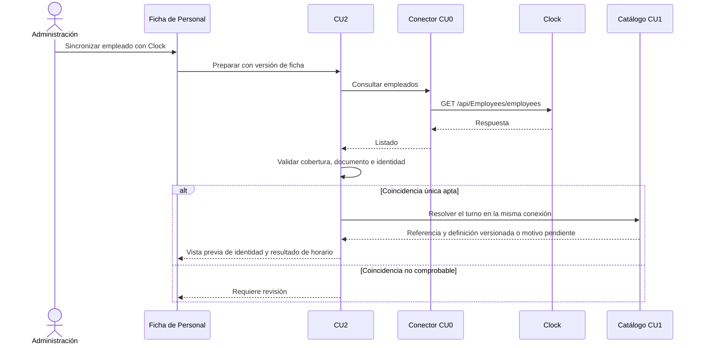
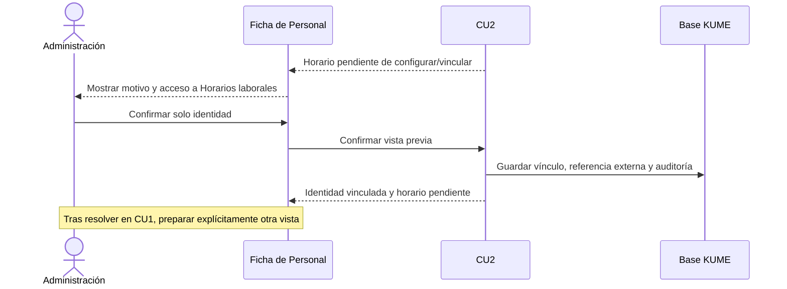
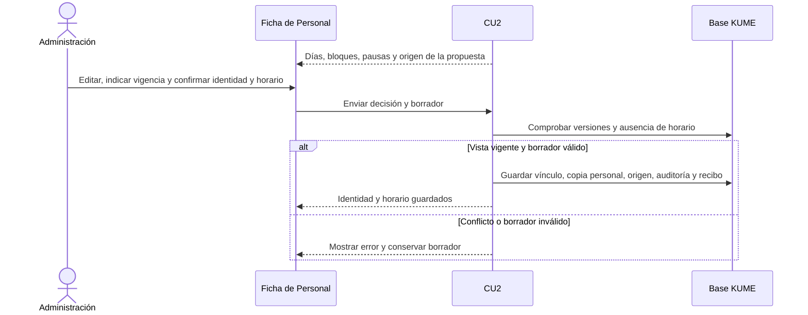
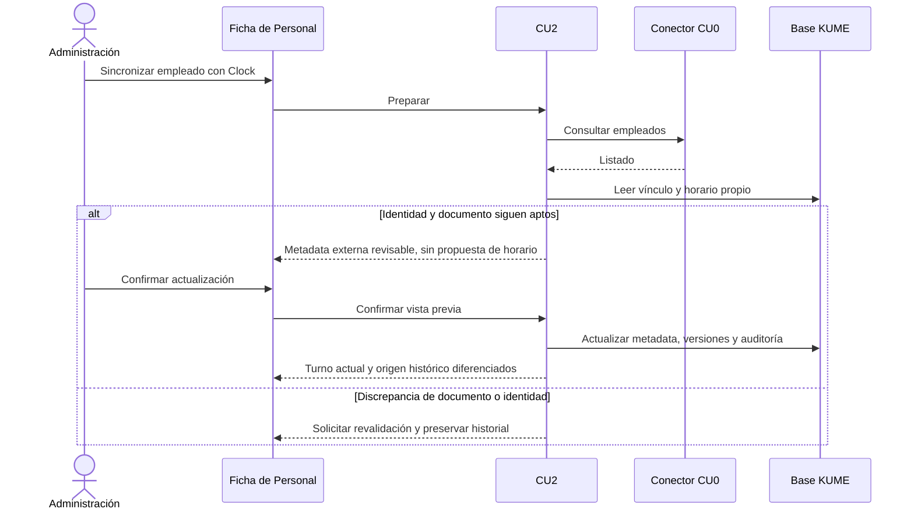

# SoftwareClock — Vinculación de empleados y resolución de turnos

[Campos y evidencia de Clock](softwareclock-api.md#respuesta-de-empleados--23112026) · [Contrato y persistencia propuestos](../specs/013-softwareclock-employee/technical-spec.md).

## Vinculación inicial y resolución

## Referencia inexistente, ambigua o sin configuración

## Confirmación del horario inicial editable

## Resincro con horario propio

