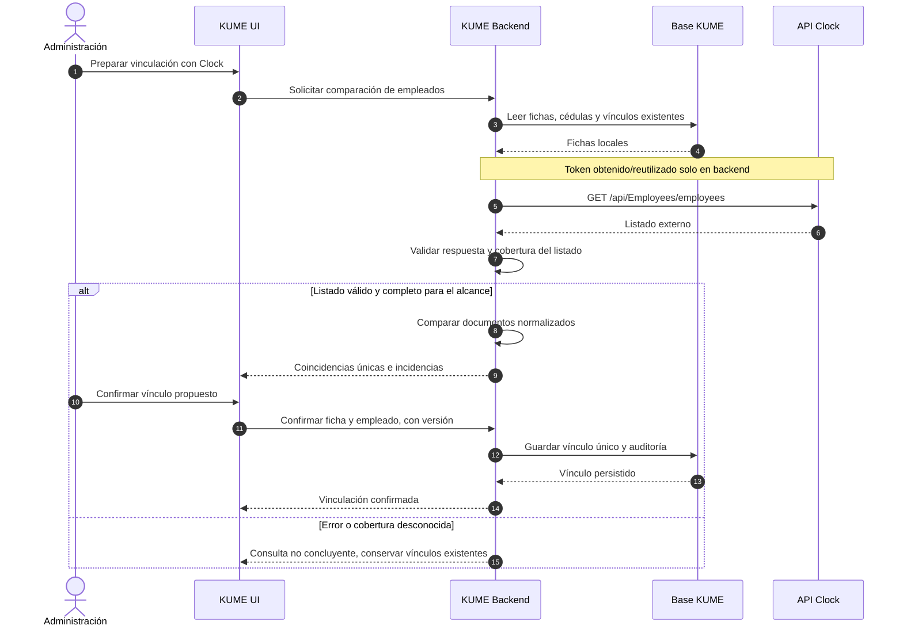
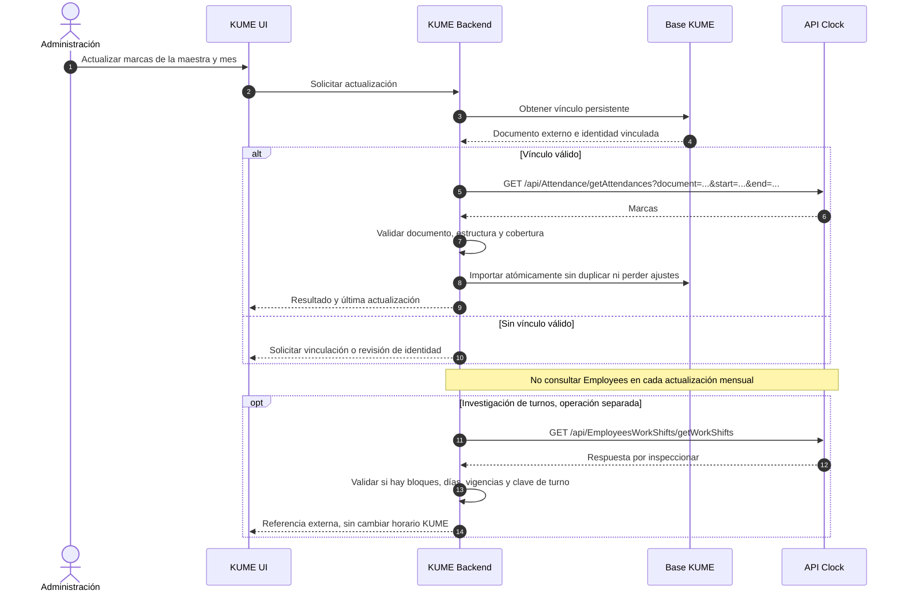

# SoftwareClock — Vinculación de empleados y consulta de turnos

> **Continuación por caso de uso:** [CU1 horarios](../functional/softwareclock/sincronizar-horarios.md), [CU2 empleado](../functional/softwareclock/sincronizar-empleado.md), [CU3 horas](../functional/softwareclock/registro-horas.md). [Índice y prompts](../functional/softwareclock/README.md). La documentación anterior conserva evidencia y contexto; los turnos ya tienen muestra de respuesta documentada.

Fecha: 23 de noviembre de 2026. Estado: diseño propuesto a partir de un registro de empleado anonimizado aportado por Maxi. Campos observados, no contrato exhaustivo del proveedor. Falta validar cobertura del listado, identidad estable, filtro de asistencias y parámetros/respuesta de turnos. No se ejecutaron solicitudes autenticadas desde el agente.

## Orden de validación

1. Obtener token con el usuario API del Portal del Empleado, flujo ya probado por Maxi.
2. Leer `/api/Employees/employees`, inspeccionar estructura exterior y cobertura; el registro individual aportado no permite concluir ausencia de paginación.
3. Proponer y confirmar vínculo ficha KUME ↔ empleado Clock, persistirlo para no repetir descubrimiento en cada apertura mensual.
4. Consultar marcas usando el `document` del vínculo con `/api/Attendance/getAttendances`, validando efectividad del filtro.
5. Consultar `/api/EmployeesWorkShifts/getWorkShifts` para determinar si aporta horarios estructurados, asignaciones o catálogo. No sustituir la referencia laboral propia de KUME por una etiqueta de Clock sin revisión funcional.

## Campos observados y destino propuesto

| Clock | Significado comprobado o candidato | Tratamiento en KUME |
| --- | --- | --- |
| `id` | Identificador presente en el registro de empleado; estabilidad/alcance pendientes | Candidato a `clockEmployeeId`; no reutilizar como ID interno KUME |
| `code` | Código presente en empleado; semántica pendiente | Conservar como `clockEmployeeCode`; no confundir con código de un evento de asistencia |
| `document` | Documento en texto | Coincidencia inicial contra cédula normalizada; conservar valor exacto del proveedor para su consulta |
| `firstName`, `lastName` | Nombre y apellido externos | Mostrar en confirmación, no usarlos como clave ni sobrescribir ficha KUME |
| `external_id` | Nulo en la muestra | No usar como clave ni asumir que permite escribir el ID KUME; no hay escritura a Clock |
| `workshiftCode` | Referencia de turno observada, por ejemplo V4 | Metadata externa, candidata a enlazar con respuesta de turnos solo tras validar su clave |
| `workShiftName` | Etiqueta observada, por ejemplo Vespertino 13-17 | Mostrar como referencia; no extraer horas analizando texto libre |
| `groupName` | Grupo externo Docente en la muestra | Contexto de confirmación; no sustituye rol ni permisos de KUME |
| `labourerType` | Valor Mensual en el ejemplo | No decide horarios, pago, recargos o reglas contables |
| `registeredDate`, `birthday` | Fechas como texto de presentación sin offset | Fuera del vínculo mínimo; no importar como fecha de ingreso/nacimiento KUME ni asumir formato local español |
| Otros campos | Flags, ubicación, contacto y tags | No necesarios para consultar marcas; no replicar sin necesidad funcional |

Identificadores numéricos se validan con el tipo real y sin pérdida de precisión; documentos nunca se convierten a número. La comparación inicial puede quitar separadores de cédula, preservando ceros; almacenar también texto externo exacto. El ejemplo anonimizado no prueba formato válido ni unicidad real del documento.

## Vínculo persistente propuesto

Unidad `clock_employee_link`: `staffMemberId`, `clockConnectionId`, `clockEmployeeId` si se confirma estable, `clockEmployeeCode`, `clockDocument` exacto, `normalizedDocument`, nombre externo para comprobación, referencias de turno observadas, `linkedAt`, `linkedBy`, `version` y estado de validación. La conexión identifica la empresa/cuenta; no inferir una empresa única global a partir de un ID.

Un vínculo vigente por ficha/conexión y, si se confirma la identidad externa estable, uno por empleado/conexión. Guardar con restricciones y versión para impedir que dos administradores vinculen el mismo empleado a fichas diferentes. La estructura y constraints son propuesta, aún sin migración ni OpenAPI.

Coincidencia única por documento → propuesta para administración. Sin coincidencia o con duplicados → incidencia, sin vinculación por nombre. Administración confirma; no forzar vínculo entre documentos distintos sin una operación explícita y validaciones diseñadas. Listado incompleto o error no habilita conclusión «empleado inexistente».

Un cambio de documento en KUME o discrepancia posterior de identidad requiere revalidación; no sustituir silenciosamente el vínculo ni reasignar importaciones históricas. Actualizar referencias informativas de turno no cambia el horario laboral KUME. Una consulta sin marcas no invalida por sí misma el vínculo.

## Secuencia de vinculación inicial propuesta



## Consulta posterior de marcas y exploración de turno



## Workshift: evidencia y límites

El registro aporta `workshiftCode` y `workShiftName`. Interpretación candidata: referencia y etiqueta del turno asignado en Clock. No acredita que exista horario semanal completo, pausas, excepciones, vigencias o tareas anticipadas. El texto Vespertino 13-17 tampoco prueba que la persona efectivamente ingrese a las 13:00 todos los días.

La colección examinada en la primera sesión incluye GET `/api/EmployeesWorkShifts/getWorkShifts` y POST `/api/EmployeesWorkShifts/assignMotherWorkShiftToEmployee`. El segundo es de escritura y queda fuera del alcance. Los parámetros específicos del GET no quedaron detallados en la documentación conservada; el adjunto original no pudo recuperarse en esta sesión. Por ello la llamada sin parámetros siguiente es exploratoria, no una garantía de que el endpoint no exija otros campos. No inventar un filtro por `id`, `document` o `workshiftCode`.

```bash
curl --request GET \
  --url 'https://api.portalempleado.softwareclock.com/api/EmployeesWorkShifts/getWorkShifts' \
  --header 'Authorization: Bearer TU_TOKEN' \
  --header 'Accept: application/json' \
  --include
```

Inspeccionar código HTTP y respuesta anonimizada o descripción de parámetros en Postman. Confirmar: listado global o por empleado, clave para V4, días, horas, pausas, vigencia y excepciones. No deducir esas relaciones del nombre del endpoint.

La regla aprobada de KUME sigue siendo precarga inicial desde cursos asignados, edición y posterior independencia del horario laboral. Usar turnos Clock como otra opción de precarga es una alternativa a evaluar con datos reales, no decisión aprobada por esta exploración. Consultar turnos y consultar marcas son operaciones diferentes.

## Catálogo de turnos observado y UX solicitada — 23/11/2026

Maxi aporta la respuesta de getWorkShifts: un array de objetos `code`, `name`, `type`. Aparecen tipos Fijo/Libre, referencias como V4 y varios códigos vacíos para nombres distintos. La muestra no contiene días, inicio/fin estructurados, pausas ni vigencias; no demuestra que ningún otro endpoint pueda devolverlos. V4 coincide entre empleado y catálogo en los ejemplos, sin acreditar unicidad global estable.

Maxi solicita botón «Sincronizar empleado con Clock» en la ficha y un apartado administrativo para importar horarios. Son ampliaciones explícitas posteriores al cierre Q1–Q31; no equivalen a autorización de sobrescribir ficha u horario laboral. La sincronización solicita/valida catálogo de empleados, propone coincidencia por documento y persiste identidad/metadata tras confirmación. Si ya existe vínculo, actualizar metadata comprobada sin reasignar por nombre, borrar auditoría, modificar datos personales KUME ni cambiar horario definido. Una discrepancia de identidad queda pendiente de revisión.

### Importación administrativa propuesta

Ruta de navegación solicitada: Administración → Horarios laborales; acción Importar desde Clock. Vista previa con código, nombre, tipo, estado local y coincidencias; confirmar importación a catálogo local con identificador KUME propio. No interpretar nombre como horario calculable.

Estados propuestos: Importado · Pendiente de configurar / Configurado / Requiere revisión. Para hacerlo calculable, administración completa días y bloques con pausas explícitas. Ejemplo: «Horario Completo 8 a 17 c/1 descanso» no indica cuándo ocurre el descanso; «Libre 0:00 a 24:00Hs.» no acredita 24 horas trabajadas ni previstas.

Códigos vacíos o duplicados no son claves externas válidas. Conservar registros distintos, usar UUID local y exigir revisión de la correspondencia al reimportar. Ni nombre ni posición en el array son identificadores estables; una coincidencia exacta de contenido puede servir para detectar una observación repetida, sin probar identidad externa. No crear un vínculo global por `code = ""` ni duplicar automáticamente registros en cada importación.

Las definiciones locales configuradas podrían servir como plantillas para completar la carga inicial de maestras. Esa alternativa a la precarga de cursos debe confirmarse explícitamente antes de incorporarla al comportamiento canónico. En cualquier caso, copiar bloques al horario laboral, no mantener herencia viva. Reimportar catálogo nunca modifica horarios laborales ya definidos ni recalcula historia silenciosamente. Igualar nombres/referencias entre sistemas no garantiza que ambos contengan la misma jornada calculable.

```mermaid
sequenceDiagram
    autonumber
    actor A as Administración
    participant UI as KUME UI
    participant BE as KUME Backend
    participant C as API Clock
    participant DB as Base KUME
    A->>UI: Horarios laborales → Importar desde Clock
    UI->>BE: Preparar importación de catálogo
    BE->>C: GET /api/EmployeesWorkShifts/getWorkShifts
    C-->>BE: Array de code, name y type
    BE->>DB: Leer correspondencias locales existentes
    DB-->>BE: Catálogo y vínculos
    BE-->>UI: Vista previa, novedades y códigos ambiguos
    A->>UI: Confirmar importación revisada
    UI->>BE: Guardar selección y correspondencias
    BE->>DB: Guardar referencias con identidad local y auditoría
    BE-->>UI: Importado; pendientes de configurar visibles
    A->>UI: Completar días, bloques y pausas de una referencia
    UI->>BE: Guardar definición local validada
    BE->>DB: Persistir definición estructurada
    Note over DB: No cambiar horarios de maestras ya definidos
```

Pendiente validar actualización del catálogo, estabilidad de códigos no vacíos y un posible endpoint de detalle antes de decidir que la configuración manual es el único camino. Diseño administrativo y estados nuevos requieren revisión visual; no se modificó MagicPath por este registro.
