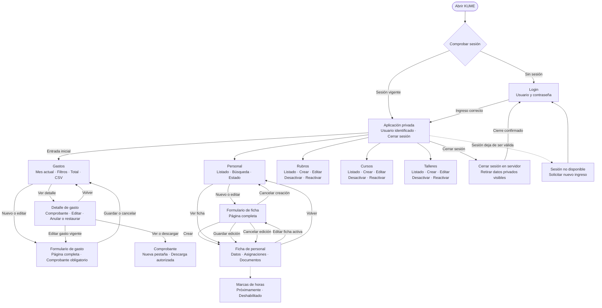
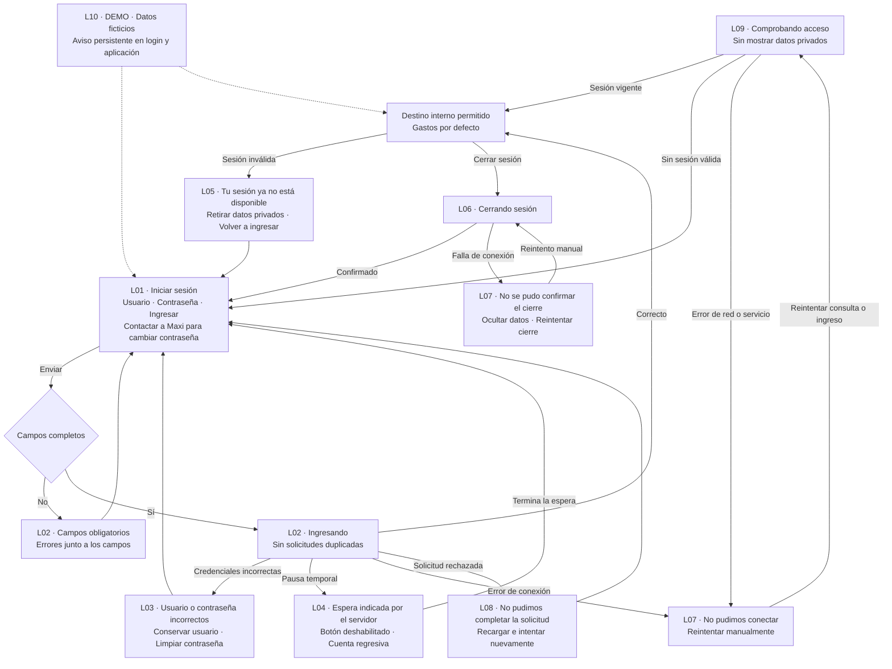
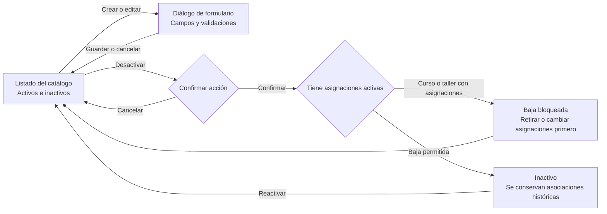

# KUME — Mapa de navegación y diseño de pantallas

**Fecha:** 2 de noviembre de 2026
**Estado:** mapa actualizado para revisión. Conserva la navegación y los bocetos de gastos y personal aprobados; incorpora autenticación según el alcance confirmado. Código del producto pendiente.

Maxi autorizó usar Markdown y Mermaid mientras MagicPath permanece sin cuota semanal. Este documento es la referencia de navegación para continuar hacia la implementación; no requiere esperar a MagicPath. La sustitución del medio de diseño no implica que exista un prototipo interactivo ni marca automáticamente el paso 4 como completo.

La imagen de referencia contiene cinco destinos permanentes: Gastos, Personal, Rubros, Cursos y Talleres. Se conserva esa estructura, con login antes del acceso privado y cierre de sesión dentro de la aplicación. Ambos usuarios tienen los mismos destinos y permisos.

## Mapa principal



La aplicación privada representa la estructura compartida, no un dashboard adicional. Los cinco destinos del menú permanecen visibles desde todas las pantallas privadas. Login no muestra el menú ni datos del sistema. Una entrada directa a una ruta privada pasa por la misma comprobación de sesión. Si hay destino interno válido solicitado, se conserva para después del ingreso; en la entrada normal se abre Gastos del mes actual.

## Login y estados de autenticación



El reintento después de un error no envía automáticamente contraseñas ni escrituras. Si falló un ingreso, conservar usuario y solicitar de nuevo la contraseña; si falló una comprobación de sesión, reintentar esa consulta. El mensaje de sesión no disponible cubre inactividad, reinicio y cambio de contraseña, sin afirmar una causa que la API no distingue.

### Estructura de la pantalla de login

```text
┌─────────────────────────────────────────────────┐
│ KUME                         [DEMO, si aplica]   │
│                                                 │
│                Iniciar sesión                   │
│                                                 │
│       Usuario                                   │
│       [________________________________]        │
│                                                 │
│       Contraseña                                │
│       [_______________________] [Mostrar]        │
│                                                 │
│       [Mensaje de estado o error, si aplica]     │
│                                                 │
│       [             Ingresar            ]       │
│                                                 │
│       Si necesitás cambiar tu contraseña,       │
│       contactá a Maxi.                          │
└─────────────────────────────────────────────────┘
```

Etiquetas persistentes, navegación por teclado, foco visible, envío con Enter, compatibilidad con gestor de contraseñas y pegado permitido. Mostrar/ocultar conserva el contenido sin enviarlo. Sin registro, recuperación por correo, administración de usuarios ni «Recordarme». No se muestran contraseñas de ejemplo ni detalles internos como cookies, hashes o cabeceras.

## Reglas de los recorridos existentes

| Área | Comportamiento que se conserva |
|---|---|
| Gastos | Guardar vuelve al listado con filtros y página; si queda fuera del filtro se ofrece «Ver gasto». Comprobante obligatorio: PDF/JPG/PNG, hasta 10 MB |
| Detalle de gasto | Consultar y descargar comprobante; reemplazo con confirmación. Gasto anulado de solo lectura hasta restaurarlo y excluido de totales |
| Personal | Crear abre Datos de la ficha; edición vuelve a la ficha. Cancelar edición vuelve a la ficha de origen; cancelar creación vuelve al listado |
| Asignaciones | Mostrar conflicto y quién ocupa el destino; ofrecer «Ver ficha» sin reemplazar automáticamente. Permitir volver a la ficha original |
| Inactivación | Solicitar fecha de egreso y confirmar las asignaciones que se retiran. Ficha inactiva de solo lectura; reactivar no recupera asignaciones |
| Documentos | Nombre libre, carga de uno por vez, consulta, descarga y eliminación con confirmación; PDF/JPG/PNG hasta 10 MB |
| Catálogos | Formularios breves en diálogos; inactivos consultables y reactivables; cancelar conserva el listado. No eliminar asociaciones históricas |
| Cursos y talleres | Bloquear baja y retirada de turnos con asignaciones; informar que primero deben retirarse o cambiarse las asignaciones |
| Estados comunes | Vacío, carga, éxito, error, validación y confirmaciones. Errores de red y servicio con reintento manual, sin repetir escrituras automáticamente |
| Sesiones | Dos cuentas con iguales permisos; 8 horas de inactividad; reinicio exige nuevo ingreso; pausa de 15 minutos tras 5 fallos por cuenta o 20 por IP en ventana de 15 minutos |
| Demo | Aviso persistente de datos ficticios en login y aplicación; aislamiento del piloto real |

## Catálogos y confirmaciones



En rubros no se aplica el bloqueo por asignación de personal: un rubro usado se desactiva y conserva sus gastos históricos. Las confirmaciones de otras acciones siguen las reglas del contrato existente; este diagrama no agrega operaciones de borrado.

## Continuación hacia el código

El nuevo medio autorizado es este mapa en Markdown, junto con las reglas y contratos existentes. MagicPath conserva valor como referencia visual y podrá retomarse con cuota; su disponibilidad ya no es condición para comenzar a implementar.

Orden de trabajo previsto: revisar este mapa, registrar ajustes si los hay y preparar el backlog de frontend/backend/infraestructura; luego revisar el estado actual de los repositorios de código, fijar versiones e implementar primero autenticación y estructura de navegación, incorporando los flujos funcionales aprobados. La seguridad se verifica en el backend, no se considera resuelta por dibujar login.

El paso 4 sigue en curso: este documento no declara aprobados nuevos bocetos, no acredita un prototipo interactivo y no marca tareas de implementación o pruebas como hechas. El criterio de continuar con código deja de depender de completar wireframes en MagicPath por instrucción de Maxi. El cierre formal del paso 4 y el backlog deben registrarse expresamente, sin reabrir los pasos 2 y 3.

Referencias: [alcance](alcance-prototipo.md), [autenticación](autenticacion-prototipo.md), [API](api-design.md), [OpenAPI](openapi.yaml) y [memoria de continuidad](continuacion-diseno-pantallas.md).
